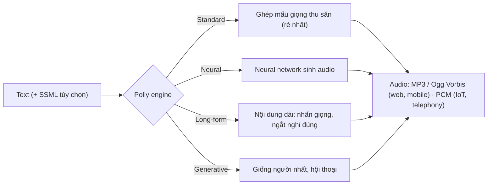

# Polly

> **TL;DR:** Amazon Polly chuyển **text → speech** nghe tự nhiên ("lifelike"). Text ở ngôn ngữ nào thì giọng nói ra ở **đúng ngôn ngữ đó**. Có 4 engine: **Standard, Neural, Long-form, Generative**. Polly chỉ làm một việc: **không dịch, không chép lời, không phân tích sentiment.**

## 🖼️ Sơ đồ
![[Polly.excalidraw]]
*Mở bằng plugin Excalidraw để chỉnh sửa · ảnh tĩnh: [[Polly.svg]]*

## Khái niệm cốt lõi
- **Input**: text (một ngôn ngữ cụ thể). **Output**: audio, cùng ngôn ngữ đó.
- Polly không phải AI assistant đa năng, nó chỉ làm **một việc**: text → speech. Giọng tốt tới đâu tùy **engine** bạn chọn.
- **Bốn engine**:
  - **Standard TTS**: kiến trúc **concatenative**, ghép các mẩu giọng nói đã thu sẵn. **Rẻ nhất**.
  - **Neural TTS (NTTS)**: dùng **neural network** để tự sinh audio thay vì ghép mẩu ghi âm, giọng **tự nhiên, giống người hơn rõ rệt**.
  - **Long-form**: hiểu **ý nghĩa** của text để nhấn giọng, ngắt nghỉ và giữ tone đúng trên **nội dung dài** như bài viết, tài liệu đào tạo.
  - **Generative**: model lớn nhất, xây bằng generative AI, thường được coi là **giống người nhất**; thiết kế cho **hội thoại**.
  - Bản khóa cũ nêu chi tiết (bài mới không nói): Standard ghép các **phoneme** (đơn vị âm nhỏ nhất của ngôn ngữ); NTTS đi phoneme → **spectrogram** → **vocoder** → audio, tính toán nặng hơn nhiều.
- **Output format**: **MP3**, **Ogg Vorbis**, **PCM**. Chọn theo cách tích hợp: MP3 hoặc Ogg Vorbis cho **ứng dụng web, mobile**; PCM cho **thiết bị IoT và điện thoại (telephony)**.
- **Chỉ một chiều, text vào, speech ra**, cùng ngôn ngữ với text:
  - cần dịch → [[Translate]];
  - speech → text → [[Transcribe]];
  - phân tích sentiment của text → [[Comprehend]].
- **SSML (Speech Synthesis Markup Language)**: chèn thẻ vào text để điều khiển *cách* Polly nói:
  - nhấn mạnh (**emphasis**) một phần câu,
  - **pronunciation**: phát âm theo cách chỉ định,
  - **whispering**: nói thì thầm,
  - kiểu nói **"Newscaster"** (giọng phát thanh viên).
- **Tích hợp**: dịch vụ AWS khác cần sinh giọng nói từ text, hoặc ứng dụng riêng qua **API**. Ví dụ: ứng dụng dùng một foundation model trên **Amazon Bedrock** để viết câu trả lời, rồi Polly đọc câu trả lời đó. Polly chủ yếu là một thành phần trong hệ thống lớn hơn. (Bản khóa cũ còn nêu plugin WordPress đọc bài blog thành audio; bài mới không nói.)

## Cách hoạt động / Kiến trúc

Pipeline đa ngôn ngữ điển hình: text tiếng Anh → [[Translate]] sang tiếng Việt → **Polly** đọc thành audio tiếng Việt.

## 🎯 Mẹo thi SAA-C03
- **Text-to-speech, "lifelike speech", đọc bài viết thành audio, sinh giọng nói cho ứng dụng** → **Polly**.
- **Bẫy**: Polly **không dịch**. Đề yêu cầu "đọc nội dung tiếng Anh bằng tiếng Tây Ban Nha" → cần **[[Translate]] rồi mới Polly**.
- Cần kiểm soát nhấn giọng, phát âm, thì thầm, phong cách đọc → **SSML**.
- Đảo chiều (speech → text) là [[Transcribe]], không phải Polly. Phân tích sentiment của text là [[Comprehend]].
- Chọn engine: rẻ nhất → **Standard**; tự nhiên hơn → **Neural**; đọc **bài viết, tài liệu đào tạo dài** đúng nhấn giọng, ngắt nghỉ → **Long-form**; giọng giống người nhất cho **hội thoại** → **Generative**.
- Output cho web/mobile → MP3 hoặc Ogg Vorbis; cho IoT, điện thoại → PCM.

## Liên kết
- Dùng cùng: [[Translate]], [[Lex]], [[Lambda]], [[S3 Basics]]
- Phân biệt với: [[Transcribe]] (speech → text), [[Lex]] (hội thoại hai chiều)
- Liên quan: [[Comprehend]]
- MOC: [[_MOC 21 Machine Learning]]
