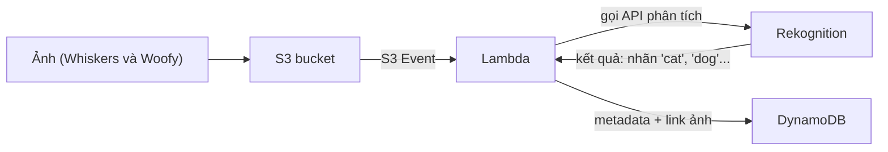

# Rekognition

> **TL;DR:** Amazon Rekognition (viết với chữ **k**) là dịch vụ **phân tích ảnh và video dựa trên deep learning**: nhận diện đối tượng, người, text, hoạt động, kiểm duyệt nội dung, phát hiện/phân tích/so sánh khuôn mặt... Trong đề, câu nào cần phân tích tổng quát ảnh/video thì **mặc định nghĩ tới Rekognition**.

## 🖼️ Sơ đồ
![[Rekognition.excalidraw]]
*Mở bằng plugin Excalidraw để chỉnh sửa · ảnh tĩnh: [[Rekognition.svg]]*

## Khái niệm cốt lõi
- **Deep learning** (một nhánh của machine learning) áp dụng cho **image** và **video**.
- **Những gì Rekognition nhận diện được**:
  - **Objects**: mèo, chó, gà, hot dog...
  - **People**, **celebrities** (ví dụ nhận ra Iron Man với 99%).
  - **Text** trong ảnh/video: biển số xe, chữ trên meme.
  - **Activities**: người trong ảnh/video đang làm gì.
  - **Content moderation**: nội dung có an toàn/phù hợp không.
  - **Face detection**, **face analysis** (cảm xúc, giới tính, mắt mở/nhắm, nghiêm túc hay vui...), **face comparison** (đối chiếu khuôn mặt với người đã biết).
  - **Pathing**: theo dõi chuyển động của người trong video (ví dụ phân tích sau trận đấu thể thao).
- **Giá**: pay-as-you-use, **theo ảnh** (per image) hoặc **theo phút video** (per minute).
- **Tích hợp**: qua API, **event-driven** (ví dụ được gọi khi ảnh upload lên S3).
- **Live video**: phân tích luồng video trực tiếp nhờ tích hợp **[[Kinesis Video Streams]]**, ví dụ nhận diện khuôn mặt trên camera an ninh để phân biệt chủ nhà với kẻ đột nhập.

> (People Pathing là tính năng AWS đã thông báo ngừng hỗ trợ từ cuối 2025; các tính năng còn lại vẫn là trọng tâm.)

## Cách hoạt động / Kiến trúc
Luồng event-driven điển hình trên slide:

1. Ảnh được upload lên [[S3 Basics|S3]].
2. [[S3 Events]] kích hoạt [[Lambda]].
3. Lambda gọi Rekognition để phân tích ảnh, nhận kết quả.
4. Lambda ghi **metadata + link tới ảnh** vào [[DynamoDB Architecture|DynamoDB]] cho các xử lý nghiệp vụ tiếp theo.

Với video trực tiếp: camera → [[Kinesis Video Streams]] → Rekognition Video → kết quả đưa vào [[Kinesis Data Streams]] để xử lý tiếp.

## 🎯 Mẹo thi SAA-C03
- Câu hỏi cần **phân tích ảnh hoặc video** về nội dung, cảm xúc, text, hoạt động, khuôn mặt, kiểm duyệt nội dung → **chọn Rekognition** (Adrian: "you should default to picking Rekognition").
- **Video trực tiếp / camera an ninh / live stream** → **Kinesis Video Streams + Rekognition**.
- Kiến trúc "upload ảnh → tự động gắn nhãn → lưu metadata" → **S3 Event → Lambda → Rekognition → DynamoDB**.
- Phân biệt text:
  - text **trong ảnh/video tự nhiên** (biển số, biển hiệu) → Rekognition;
  - trích xuất text **từ tài liệu** (form, bảng, hóa đơn, ID) kèm cấu trúc → [[Textract]].
- Kiểm duyệt nội dung ảnh do người dùng upload (unsafe content) → Rekognition content moderation.

## Liên kết
- Tiên quyết: [[S3 Events]], [[Lambda]], [[Event-Driven Architecture]]
- Dùng cùng: [[Kinesis Video Streams]], [[DynamoDB Architecture]], [[Serverless Architecture]]
- Phân biệt với: [[Textract]] (tài liệu), [[Comprehend]] (text)
- MOC: [[_MOC 21 Machine Learning]]
