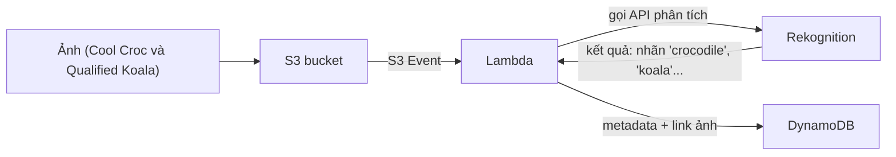
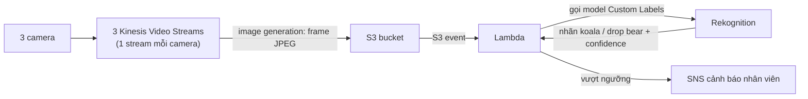

# Rekognition

> **TL;DR:** Amazon Rekognition (viết với chữ **k**) là dịch vụ **pre-trained phân tích ảnh và video dựa trên deep learning** (gọi API là có kết quả, không phải tự train model): nhận diện đối tượng, người, text, hoạt động, kiểm duyệt nội dung, phát hiện/phân tích/so sánh khuôn mặt... Trong đề, câu nào cần phân tích tổng quát ảnh/video thì **mặc định nghĩ tới Rekognition**.

## 🖼️ Sơ đồ
![[Rekognition.excalidraw]]
*Mở bằng plugin Excalidraw để chỉnh sửa · ảnh tĩnh: [[Rekognition.svg]]*

## Khái niệm cốt lõi
- **Deep learning** (một nhánh của machine learning) áp dụng cho **image** và **video**.
- **Pre-trained, single purpose**: không có model nào phải build hay train như trên [[SageMaker|SageMaker AI]], cũng không phải viết prompt cho LLM. Bạn gọi API và nhận kết quả.
- **Những gì Rekognition nhận diện được**:
  - **Objects**: mèo, chó, gà, hot dog...
  - **People**, **celebrities** (ví dụ nhận ra Paul Hogan, "Crocodile Dundee", với 99%; con cá sấu trong ảnh 67%).
  - **Text** trong ảnh/video: biển số xe, chữ trên meme. **Giới hạn tối đa 100 từ mỗi ảnh**, nên không dành cho tài liệu nhiều chữ.
  - **Activities**: người trong ảnh/video đang làm gì.
  - **Content moderation**: nội dung có an toàn/phù hợp không.
  - **Face detection**, **face analysis** (cảm xúc, giới tính, mắt mở/nhắm, ví dụ "Male, Eyes open, Calm"), **face comparison** (đối chiếu khuôn mặt với người đã biết trong ảnh và video).
  - **Pathing**: theo dõi chuyển động của người trong video (ví dụ phân tích sau trận đấu thể thao) (bản khóa cũ nêu, bài mới không nói).
- **Giá**: pay-as-you-use, **theo ảnh** (per image) hoặc **theo phút video** (per minute).
- **Tích hợp**: qua API, **event-driven** (ví dụ được gọi khi ảnh upload lên S3).
- **Video live**: bài Rekognition mới không nói. Bài [[Kinesis Video Streams]] mới dùng KVS **trích frame thành ảnh JPEG vào S3**, rồi S3 event → Lambda → Rekognition phân tích từng ảnh.
- **Custom Labels** (theo bài Kinesis Video Streams): Rekognition không tự biết mọi thứ (ví dụ "drop bear"), nên bạn train một **custom labels model** bằng vài trăm ảnh đã gắn nhãn; model trả về nhãn kèm **confidence score**.
- Bản khóa cũ nêu (bài mới không nói): Rekognition Video tích hợp trực tiếp với Kinesis Video Streams để phân tích luồng live, ví dụ nhận diện khuôn mặt trên camera an ninh để phân biệt chủ nhà với kẻ đột nhập.

> (People Pathing là tính năng AWS đã thông báo ngừng hỗ trợ từ cuối 2025; các tính năng còn lại vẫn là trọng tâm.)

## Cách hoạt động / Kiến trúc
Luồng event-driven điển hình trên slide:

1. Ảnh được upload lên [[S3 Basics|S3]].
2. [[S3 Events]] kích hoạt [[Lambda]].
3. Lambda gọi Rekognition để phân tích ảnh, nhận kết quả.
4. Lambda ghi **metadata + link tới ảnh** vào [[DynamoDB Architecture|DynamoDB]] cho các xử lý nghiệp vụ tiếp theo.

Với video trực tiếp (ví dụ trạm giám sát drop bear trong bài [[Kinesis Video Streams]]):

Lambda có thể gọi model bất kỳ, kể cả model bạn tự train và host trên [[SageMaker|SageMaker AI]]. Bản khóa cũ nêu (bài mới không nói): camera → [[Kinesis Video Streams]] → Rekognition Video → kết quả đưa vào [[Kinesis Data Streams]] để xử lý tiếp.

## 🎯 Mẹo thi SAA-C03
- Câu hỏi cần **phân tích ảnh hoặc video** về nội dung, cảm xúc, text, hoạt động, khuôn mặt, kiểm duyệt nội dung → **chọn Rekognition** (giảng viên: "you should really seriously consider using Rekognition").
- **Video trực tiếp / camera / live stream** cần phân tích → **Kinesis Video Streams** (trích ảnh ra S3) + Lambda + **Rekognition**.
- Cần nhận ra đối tượng riêng mà Rekognition chưa biết → **Rekognition Custom Labels** (train bằng vài trăm ảnh đã gắn nhãn, theo bài Kinesis Video Streams).
- Kiến trúc "upload ảnh → tự động gắn nhãn → lưu metadata" → **S3 Event → Lambda → Rekognition → DynamoDB**.
- Phân biệt text:
  - text **trong ảnh/video tự nhiên** (biển số, biển hiệu) → Rekognition;
  - **nhiều text** hoặc trích text **từ tài liệu** (form, bảng, hóa đơn, PDF, ID) kèm cấu trúc → [[Textract]]. Rekognition chỉ đọc tối đa 100 từ mỗi ảnh.
- Kiểm duyệt nội dung ảnh do người dùng upload (unsafe content) → Rekognition content moderation.

## Liên kết
- Tiên quyết: [[S3 Events]], [[Lambda]], [[Event-Driven Architecture]]
- Dùng cùng: [[Kinesis Video Streams]], [[DynamoDB Architecture]], [[Serverless Architecture]]
- Phân biệt với: [[Textract]] (tài liệu), [[Comprehend]] (text), [[SageMaker]] (tự train model)
- MOC: [[_MOC 21 Machine Learning]]
