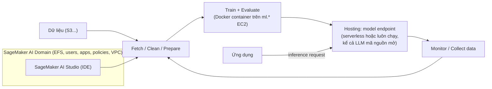

# SageMaker

> **TL;DR:** **Amazon SageMaker AI** (bản khóa cũ gọi là Amazon SageMaker) là **dịch vụ machine learning được quản lý hoàn toàn**, gom nhiều sản phẩm và tính năng phục vụ **toàn bộ vòng đời ML**: lấy dữ liệu, làm sạch, chuẩn bị, huấn luyện, đánh giá, triển khai, giám sát. Dùng khi bạn cần **tự build, train, deploy model của mình**; bài toán có sẵn AI service thì gọi AI service, cần LLM có sẵn thì gọi qua **Amazon Bedrock**. Bản thân SageMaker AI **không tính phí**, nhưng **mọi thứ chạy trong nó thì có** (và có thể rất đắt).

## 🖼️ Sơ đồ
![[SageMaker.excalidraw]]
*Mở bằng plugin Excalidraw để chỉnh sửa · ảnh tĩnh: [[SageMaker.svg]]*

![[SageMaker - choose.excalidraw]]
*Mở bằng plugin Excalidraw để chỉnh sửa · ảnh tĩnh: [[SageMaker - choose.svg]]*

## Khái niệm cốt lõi
- **Tên gọi**: bài mới gọi dịch vụ này là **Amazon SageMaker AI**. Tên **Amazon SageMaker** (không có chữ AI) là **nền tảng data analytics và AI rộng hơn** của AWS; SageMaker AI là dịch vụ machine learning nằm trong nền tảng đó.
- **Khi nào dùng**: khi cần **build, train hoặc deploy model của chính bạn**, với toàn quyền kiểm soát:
  - không phải gọi một AI service pre-trained như [[Rekognition]] hay [[Comprehend]];
  - cần một **large language model** có sẵn (như Claude, ChatGPT) thì thường gọi qua **Amazon Bedrock**;
  - SageMaker AI là khi bạn muốn tự train hoặc tự host model.
- **Machine learning lifecycle** mà SageMaker AI bao phủ: **Fetch → Clean → Prepare → Train → Evaluate → Deploy → Monitor/Collect** (thu thập dữ liệu mới để lặp lại).
- **SageMaker AI Studio**: giao diện web có nhiều **IDE** để chọn, dùng cho cả vòng đời ML. Build, train, debug và monitor model trong một môi trường phát triển.
- **SageMaker AI Domain**: đơn vị **cô lập/nhóm** cho một dự án. Mỗi domain gồm **[[EFS]] volume**, **users**, **apps**, **policies**, **cấu hình VPC**. Phải tạo domain mới vào được hầu hết các môi trường của SageMaker AI, kể cả Studio.
- **Containers**: **Docker container** chạy trên **ML EC2 instance** (các instance type bắt đầu bằng `ml.`, ví dụ `ml.m5.xlarge`, thiết kế cho workload ML). Mỗi container là một môi trường ML với phiên bản OS, thư viện, tooling cụ thể cho từng nhiệm vụ; AWS có sẵn nhiều **pre-built container**.
- **Hosting**: triển khai model thành **endpoint** cho ứng dụng gọi tới, kể cả **LLM mã nguồn mở** nếu bạn muốn tự host. Có nhiều kiến trúc hosting, từ **serverless** đến **compute chạy liên tục**.
- **Chi phí**:
  - **Không có phí** cho bản thân SageMaker AI hay SageMaker AI Studio.
  - Bạn trả cho **từng thứ chạy bên trong**: notebook, training job, hosted model. Mỗi thứ chạy trên **ML instance riêng** và tính tiền suốt thời gian instance chạy, cộng thêm storage.
  - Pricing vì thế **phức tạp**, và ML instance thường **đắt**, nhất là model lớn cần **GPU**.
  - Chạy quanh năm thì cân nhắc **SageMaker AI Savings Plans**. **Compute Savings Plans không áp dụng** cho SageMaker AI.
- SAA-C03 chỉ cần mức kiến trúc tổng quan; hiểu sâu là việc của các chứng chỉ ML chuyên sâu như **ML Engineer Associate** (bản khóa cũ nói ML Specialty).

> (Bổ sung, bài không nói: AWS đổi tên từ 12/2024; nền tảng "Amazon SageMaker" mới đi kèm SageMaker Unified Studio.)

## Cách hoạt động / Kiến trúc

## Bảng so sánh / số liệu
| Nhu cầu | Chọn |
|---|---|
| Tự xây, huấn luyện, deploy hoặc tự host **model ML tùy chỉnh** (kể cả LLM mã nguồn mở) | **SageMaker AI** |
| Bài toán phổ biến có sẵn API (ảnh, text, giọng nói, dịch...) | AI services: [[Rekognition]], [[Comprehend]], [[Transcribe]], [[Polly]], [[Translate]], [[Textract]]... |
| Dùng LLM có sẵn (như Claude) trong ứng dụng | **Amazon Bedrock** |
| Dự báo time-series / phát hiện gian lận dạng managed (bản khóa cũ) | [[Forecast]] / [[Fraud Detector]] |
| Giảm chi phí khi chạy quanh năm | **SageMaker AI Savings Plans** (Compute Savings Plans không áp dụng) |

## 🎯 Mẹo thi SAA-C03
- Đề nói **"data scientists build, train and deploy custom ML models"**, "fully managed ML platform", "end-to-end ML lifecycle" → **SageMaker AI**.
- **SageMaker AI Studio** = IDE cho ML. **SageMaker AI Domain** = vùng cô lập cho một dự án (EFS, users, VPC).
- Model cần phục vụ cho ứng dụng → **SageMaker AI endpoint (hosting)**; tự host LLM mã nguồn mở cũng dùng endpoint này.
- Cần dùng **LLM có sẵn** → **Amazon Bedrock**, không phải SageMaker AI.
- Nếu đã có dịch vụ AI chuyên dụng giải đúng bài toán (ví dụ nhận diện khuôn mặt) → chọn dịch vụ đó thay vì tự train trên SageMaker AI, ít công sức vận hành hơn.
- SageMaker AI miễn phí nhưng **mọi thứ chạy trong nó thì không**. Câu hỏi chi phí: chú ý endpoint chạy liên tục, instance `ml.*` lớn, GPU. Chạy quanh năm → **SageMaker AI Savings Plans** (Compute Savings Plans không áp dụng).

## Liên kết
- Tiên quyết: [[Containers Fundamentals]], [[EC2 Instance Types]], [[EFS]], [[Custom VPC]]
- Liên quan: [[ECR]], [[S3 Basics]], [[IAM Roles]], [[Reserved Instances and Savings Plans]], [[FSx for Lustre]]
- Phân biệt với: [[Rekognition]], [[Comprehend]], [[Translate]], [[Forecast]]
- MOC: [[_MOC 21 Machine Learning]]
