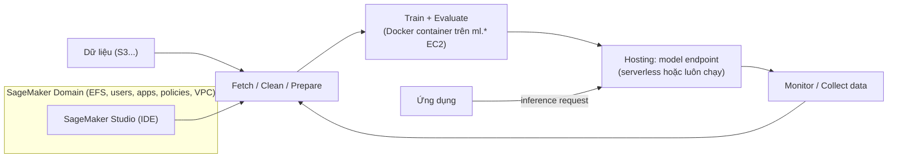

# SageMaker

> **TL;DR:** Amazon SageMaker là **dịch vụ machine learning được quản lý hoàn toàn**, gom nhiều sản phẩm và tính năng phục vụ **toàn bộ vòng đời ML**: lấy dữ liệu, làm sạch, chuẩn bị, huấn luyện, đánh giá, triển khai, giám sát. Bản thân SageMaker **không tính phí**, nhưng **tài nguyên nó tạo ra thì có** (và có thể rất đắt).

## 🖼️ Sơ đồ
![[SageMaker.excalidraw]]
*Mở bằng plugin Excalidraw để chỉnh sửa · ảnh tĩnh: [[SageMaker.svg]]*

![[SageMaker - choose.excalidraw]]
*Mở bằng plugin Excalidraw để chỉnh sửa · ảnh tĩnh: [[SageMaker - choose.svg]]*

## Khái niệm cốt lõi
- **Machine learning lifecycle** mà SageMaker bao phủ: **Fetch → Clean → Prepare → Train → Evaluate → Deploy → Monitor/Collect** (thu thập dữ liệu mới để lặp lại).
- **SageMaker Studio**: **IDE cho vòng đời ML**. Build, train, debug và monitor model trong một môi trường phát triển.
- **SageMaker Domain**: đơn vị **cô lập/nhóm** cho một dự án. Mỗi domain gồm **[[EFS]] volume**, **users**, **apps**, **policies**, **cấu hình VPC**. Phải tạo domain trước khi làm việc với SageMaker (Studio).
- **Containers**: **Docker container** chạy trên **ML EC2 instance** (các instance type bắt đầu bằng `ml.`, ví dụ `ml.m5.xlarge`, thiết kế cho workload ML). Mỗi container là một môi trường ML với phiên bản OS, thư viện, tooling cụ thể cho từng nhiệm vụ; AWS có sẵn nhiều **pre-built container**.
- **Hosting**: triển khai model thành **endpoint** cho ứng dụng gọi tới. Có nhiều kiến trúc hosting, từ **serverless** đến **compute chạy liên tục**.
- **Chi phí**: SageMaker không thu phí riêng; trả tiền cho **tài nguyên được tạo** (compute training, endpoint, storage...). Pricing **phức tạp**, và do yêu cầu tính toán của ML, tài nguyên thường **lớn và tốn kém**.
- SAA-C03 chỉ cần mức kiến trúc tổng quan; hiểu sâu là việc của chứng chỉ ML Specialty.

> (khóa học gọi chung là "SageMaker"; từ 12/2024 AWS đổi tên dịch vụ này thành **Amazon SageMaker AI**, còn tên "Amazon SageMaker" dùng cho nền tảng hợp nhất dữ liệu + AI với SageMaker Unified Studio.)

## Cách hoạt động / Kiến trúc

## Bảng so sánh / số liệu
| Nhu cầu | Chọn |
|---|---|
| Tự xây, huấn luyện, deploy **model ML tùy chỉnh** | **SageMaker** |
| Bài toán phổ biến có sẵn API (ảnh, text, giọng nói, dịch...) | AI services: [[Rekognition]], [[Comprehend]], [[Transcribe]], [[Polly]], [[Translate]], [[Textract]]... |
| Dự báo time-series / phát hiện gian lận dạng managed | [[Forecast]] / [[Fraud Detector]] |

## 🎯 Mẹo thi SAA-C03
- Đề nói **"data scientists build, train and deploy custom ML models"**, "fully managed ML platform", "end-to-end ML lifecycle" → **SageMaker**.
- **SageMaker Studio** = IDE cho ML. **SageMaker Domain** = vùng cô lập cho một dự án (EFS, users, VPC).
- Model cần phục vụ cho ứng dụng → **SageMaker endpoint (hosting)**.
- Nếu đã có dịch vụ AI chuyên dụng giải đúng bài toán (ví dụ nhận diện khuôn mặt) → chọn dịch vụ đó thay vì tự train trên SageMaker, ít công sức vận hành hơn.
- SageMaker miễn phí nhưng **tài nguyên thì không**. Câu hỏi chi phí: chú ý endpoint chạy liên tục và instance `ml.*` lớn.

## Liên kết
- Tiên quyết: [[Containers Fundamentals]], [[EC2 Instance Types]], [[EFS]], [[Custom VPC]]
- Liên quan: [[ECR]], [[S3 Basics]], [[IAM Roles]]
- Phân biệt với: [[Rekognition]], [[Comprehend]], [[Forecast]]
- MOC: [[_MOC 21 Machine Learning]]
