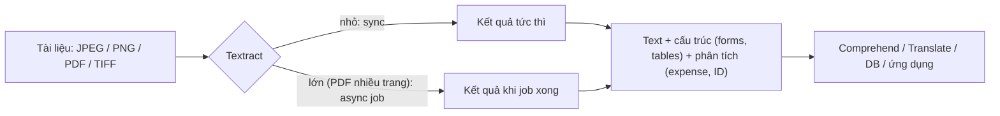

# Textract

> **TL;DR:** Amazon Textract **phát hiện và phân tích text trong tài liệu** (ảnh scan, PDF). Không chỉ OCR: nó trích luôn **cấu trúc** (form key-value, bảng) và **phân tích chuyên biệt** cho hóa đơn/biên lai và giấy tờ tùy thân.

## 🖼️ Sơ đồ
![[Textract.excalidraw]]
*Mở bằng plugin Excalidraw để chỉnh sửa · ảnh tĩnh: [[Textract.svg]]*

## Khái niệm cốt lõi
- **Input**: **JPEG, PNG, PDF, TIFF**.
- **Output**: **text đã trích xuất**, **cấu trúc** của text đó (quan hệ giữa các phần, vị trí xuất hiện, metadata) và **kết quả phân tích**.
- **Chế độ xử lý**:
  - **Synchronous (real-time)**: hầu hết tài liệu cỡ thường, kết quả gần như tức thì.
  - **Asynchronous**: tài liệu **lớn** (ví dụ PDF hàng trăm trang). Submit job rồi chờ xử lý xong.
- **Giá**: **pay for usage**; có **custom pricing** cho khối lượng lớn.
- **Khả năng**:
  - Phát hiện text **và quan hệ giữa các phần text**. Ví dụ trên hóa đơn: dòng sản phẩm nào đi với giá nào, thuế bao nhiêu.
  - Sinh **metadata**: text nằm ở đâu trong tài liệu.
  - Đọc được chữ **in, viết tay, đóng dấu**, chữ nghiêng hoặc tràn khỏi ô.
- **Phân tích theo loại tài liệu**:
  | Loại | Trích được |
  |---|---|
  | Tài liệu chung (**Analyze Document**) | Raw text, **Forms** (key-value), **Tables** (giữ cấu trúc bảng), **Queries**; tên, địa chỉ, ngày sinh |
  | Biên lai/hóa đơn (**Analyze Expense**) | **Vendor**, giá, **line items**, ngày |
  | Giấy tờ tùy thân (**Analyze ID**) | Các trường chuẩn hóa: số giấy phép lái xe và số hộ chiếu đều quy về **Document number** |
- **Field abstraction** cho ID: nhiều loại giấy tờ khác nhau được map về **một schema chung** (Document ID, First/Last name, Date of birth, Expiration date...), lưu vào cùng một database. Rất có giá trị cho **KYC (Know Your Customer)** và **AML (anti-money laundering)**.
- Dùng qua **console UI** hoặc **API**; tích hợp với ứng dụng và các dịch vụ AWS khác, kể cả các dịch vụ ML khác.

## Cách hoạt động / Kiến trúc

## Demo / Lab
- Console → **Try Amazon Textract** → **Analyze Document** với mẫu **vaccination card**: dữ liệu vừa có cấu trúc (họ, tên, ngày sinh, mã bệnh nhân) vừa là bảng ngày tiêm (viết tay, đóng dấu, lệch khỏi ô) → vẫn trích đúng từng phần tử.
- Mẫu **paystub**: rất nhiều bảng phức tạp; tab **Tables** cho thấy Textract tái tạo được **cấu trúc bảng** (nhiều bảng trong một tài liệu).
- Mẫu **loan application**: trích cả đoạn văn dài.
- **Analyze Expense**: biên lai siêu thị → trích **vendor** và từng line item.
- **Analyze ID**: driver's license và passport → số giấy phép và số hộ chiếu đều được trả về dưới trường **Document number**.
- Console demo giới hạn tài liệu upload: < 11 trang, < 5 MB.

## 🎯 Mẹo thi SAA-C03
- **Trích text/dữ liệu từ tài liệu scan, PDF, form, bảng, hóa đơn, biên lai, hộ chiếu, bằng lái** → **Textract**.
- **OCR có cấu trúc** (giữ key-value, bảng) → Textract, không phải [[Rekognition]]. Rekognition đọc text trong ảnh tự nhiên (biển số), không hiểu form/bảng.
- Tài liệu lớn nhiều trang → **asynchronous** API (start job rồi lấy kết quả, thường kèm thông báo qua [[SNS]]).
- Pipeline phổ biến: S3 upload → [[Lambda]] → Textract → [[Comprehend]] (tìm entity/PII) → lưu DB.

## Liên kết
- Dùng cùng: [[S3 Events]], [[Lambda]], [[Comprehend]], [[Translate]], [[SNS]]
- Phân biệt với: [[Rekognition]] (ảnh/video), [[Comprehend]] (phân tích text đã có)
- Liên quan: [[Kendra]]
- MOC: [[_MOC 21 Machine Learning]]
