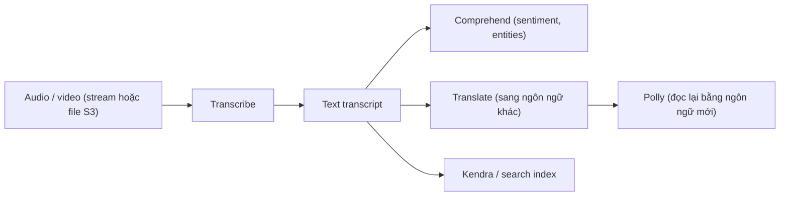

# Transcribe

> **TL;DR:** Amazon Transcribe là dịch vụ **Automatic Speech Recognition (ASR)**: **input = audio (giọng nói)**, **output = text**. Có các tính năng tùy biến ngôn ngữ, lọc nội dung/PII, nhận diện người nói; tính tiền **theo giây** audio được chuyển đổi.

## 🖼️ Sơ đồ
![[Transcribe.excalidraw]]
*Mở bằng plugin Excalidraw để chỉnh sửa · ảnh tĩnh: [[Transcribe.svg]]*

## Khái niệm cốt lõi
- **Audio → text**. Ngược với [[Polly]] (text → audio).
- **Tính năng cải thiện chất lượng**:
  - **Language customization**: chọn ngôn ngữ cụ thể hoặc **automatic language identification**.
  - **Filters for privacy**: **PII identification & redaction**.
  - **Audience-appropriate language**: **vocabulary filtering** (che/xóa/gắn tag các từ không mong muốn).
  - **Speaker identification**: phân biệt từng người nói (speaker diarization).
  - **Custom vocabularies** (thuật ngữ riêng của ngành/doanh nghiệp) và **custom language models**.
  - **Partial results stabilization** khi streaming.
- **Hai cách dùng**: **real-time transcription** (streaming, ví dụ qua HTTP/2 hoặc WebSocket) và **transcription jobs** (batch, file audio trên S3).
- **Giá**: pay-as-you-use, **per second** của audio được transcribe.
- **Các biến thể**:
  - **Transcribe** (chuẩn).
  - **Transcribe Medical**: thuật ngữ y khoa.
  - **Transcribe Call Analytics**: phân tích cuộc gọi: đặc điểm cuộc gọi, **tóm tắt (summarization)**, **categories**, **sentiment** của người nói.

## Cách hoạt động / Kiến trúc

Text đầu ra thường được đưa tiếp sang các dịch vụ ML khác để phân tích sâu hơn.

## Demo / Lab
- Console → **Real-time transcription** → **Start streaming**, nói "I like cats, dogs, chickens and rabbits. Spiders, not so much." → **Stop streaming** → text hiện ngay, có thể **Download full transcript**. Console demo giới hạn mỗi stream 15 phút.
- Các tùy chọn: ngôn ngữ cụ thể hoặc auto-detect, bật/tắt speaker identification, vocabulary filtering, PII redaction, custom vocabulary, partial results stabilization, custom language model.
- Mục **Application integration** cho thấy ví dụ request/response API streaming để tích hợp vào ứng dụng.
- Menu trái có **Call Analytics** và **Transcribe Medical**.

## Bảng so sánh / số liệu
| Use case | Mô tả |
|---|---|
| **Full-text indexing** audio | Chuyển audio thành text để **search** được |
| **Meeting notes** | Bản ghi text đầy đủ của cuộc họp |
| **Subtitles / captions / transcripts** | Phụ đề cho video của tổ chức |
| **Call analytics** | Đặc điểm cuộc gọi, tóm tắt, categories, sentiment |
| **Integration** | Với ứng dụng riêng (API) và các dịch vụ AWS ML khác |

## 🎯 Mẹo thi SAA-C03
- **Speech-to-text, chuyển audio/cuộc gọi/video thành text, tạo phụ đề, transcript cuộc họp** → **Transcribe**.
- **Bẫy phân biệt**:
  - [[Polly]] = text → speech (ngược chiều).
  - [[Lex]] cũng có ASR nhưng để **hội thoại/chatbot**; chỉ cần chép lại lời nói → Transcribe.
  - [[Translate]] = text → text khác ngôn ngữ. Audio tiếng Nhật thành text tiếng Anh → **Transcribe + Translate**.
- Phân tích **cảm xúc khách hàng trong cuộc gọi** → Transcribe (Call Analytics) hoặc Transcribe + [[Comprehend]].
- Cần **ẩn PII trong transcript** → bật **PII redaction** của Transcribe.
- Ngành y → **Transcribe Medical**.

## Liên kết
- Dùng cùng: [[Comprehend]], [[Translate]], [[Kendra]], [[S3 Basics]], [[Lambda]]
- Phân biệt với: [[Polly]], [[Lex]]
- MOC: [[_MOC 21 Machine Learning]]
