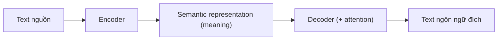
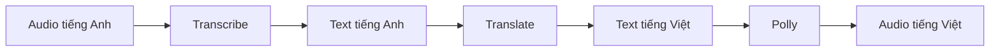

# Translate

> **TL;DR:** Amazon Translate là dịch vụ **dịch text → text** giữa các ngôn ngữ, dựa trên ML (neural machine translation). Nó dịch **ý nghĩa** chứ không thay từng từ một, và thường được dùng như **một bước trong pipeline** cùng các dịch vụ khác.

## 🖼️ Sơ đồ
![[Translate.excalidraw]]
*Mở bằng plugin Excalidraw để chỉnh sửa · ảnh tĩnh: [[Translate.svg]]*

## Khái niệm cốt lõi
- Dịch text từ ngôn ngữ gốc sang ngôn ngữ khác.
- **Hai phần của quá trình dịch**:
  - **Encoder**: đọc text nguồn → tạo **semantic representation** (biểu diễn ý nghĩa).
  - **Decoder**: đọc ý nghĩa đó → viết ra **ngôn ngữ đích**.
  - Lý do: cách diễn đạt một ý giữa các ngôn ngữ khác nhau, không phải lúc nào cũng dịch thẳng từ-sang-từ.
- **Attention mechanism**: xác định từ nào trong câu nguồn quan trọng nhất cho từng phần của câu đích, giúp xử lý từ/cụm từ **mơ hồ** và bảo đảm **ý nghĩa** được dịch đúng.
- **Auto-detect** ngôn ngữ nguồn, hoặc bạn chỉ định ngôn ngữ nguồn rõ ràng.

## Cách hoạt động / Kiến trúc

Pipeline thường gặp:

## Bảng so sánh / số liệu
| Use case | Ví dụ |
|---|---|
| **Multilingual user experience** | Meeting notes, posts, communications, articles nội bộ cho nhân viên ở nhiều quốc gia |
| Giao tiếp bằng ngôn ngữ của khách | Email, **in-game chat**, customer **live chat** |
| Dịch **incoming data** | Social media, tin tức, thông tin liên lạc sang ngôn ngữ của nhân viên xử lý |
| **Language independence** cho dịch vụ AWS khác | Cho [[Comprehend]], [[Transcribe]], [[Polly]] hoạt động không phụ thuộc ngôn ngữ; dịch dữ liệu lưu trong S3, RDS, DynamoDB |
| Tích hợp | Với dịch vụ AWS, ứng dụng tự phát triển, nền tảng khác |

## 🎯 Mẹo thi SAA-C03
- Bất kỳ kịch bản **dịch text sang text** → **Translate**.
- Nếu dịch là **một phần của quy trình** → Translate là một bước trong chuỗi:
  - dịch rồi **đọc lên** → Translate + [[Polly]];
  - audio ngôn ngữ A → text ngôn ngữ B → [[Transcribe]] + Translate.
- **Bẫy**: [[Polly]] và [[Transcribe]] **không dịch**. Thấy đổi ngôn ngữ là cần Translate.
- Phân tích sentiment cho review viết bằng nhiều ngôn ngữ → Translate (chuẩn hóa ngôn ngữ) + [[Comprehend]].

## Liên kết
- Dùng cùng: [[Transcribe]], [[Polly]], [[Comprehend]], [[Lambda]]
- Nguồn dữ liệu: [[S3 Basics]], [[RDS Architecture]], [[DynamoDB Architecture]]
- Phân biệt với: [[Polly]], [[Transcribe]]
- MOC: [[_MOC 21 Machine Learning]]
