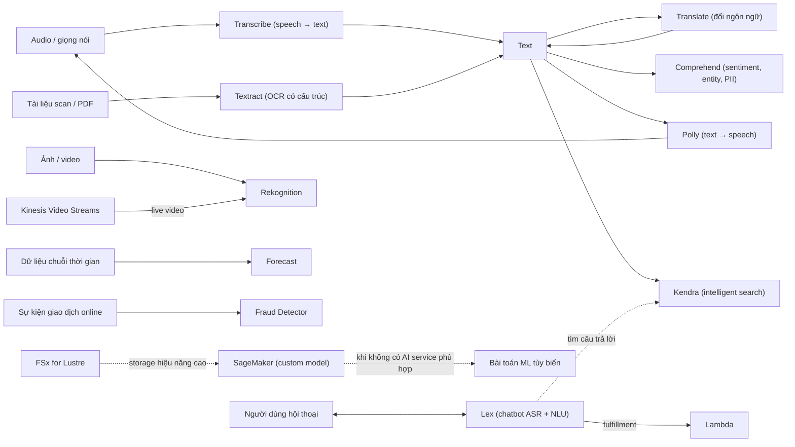

# 21 Machine Learning

Section cuối về nội dung kỹ thuật giới thiệu các dịch vụ AI/ML managed của AWS: nhóm ngôn ngữ (Comprehend, Kendra, Lex, Polly, Transcribe, Translate), nhóm thị giác và tài liệu (Rekognition, Textract), nhóm dự báo và gian lận (Forecast, Fraud Detector) và nền tảng tự xây model SageMaker. Đề SAA-C03 chỉ hỏi ở mức "dịch vụ nào cho input/output nào", nên cần nắm từ khóa và cách ghép các dịch vụ thành pipeline. Sau section này là phần ôn thi ở [[_MOC 00 Course and Exam]] và [[Exam Cheat Sheet]].

← [[00 Home]] · Trước: [[_MOC 20 NoSQL and Analytics]] · Tiếp: [[Exam Cheat Sheet]]

## Lộ trình học
1. [[Comprehend]] — NLP managed: từ text ra entities, key phrases, ngôn ngữ, PII, sentiment, syntax.
2. [[Kendra]] — intelligent search bằng ngôn ngữ tự nhiên trên kho tài liệu nội bộ, là backend service.
3. [[Lex]] — xây chatbot/voice bot với ASR + NLU; "Lex for Alexa", fulfillment thường bằng Lambda.
4. [[Polly]] — text → speech tự nhiên, cùng ngôn ngữ với text; Polly không dịch.
5. [[Rekognition]] — phân tích ảnh/video bằng deep learning: đối tượng, khuôn mặt, text trong ảnh, kiểm duyệt nội dung.
6. [[Textract]] — trích text và cấu trúc (form, bảng, hóa đơn, giấy tờ tùy thân) từ tài liệu scan/PDF.
7. [[Transcribe]] — ASR: audio → text, có PII redaction, nhận diện người nói, Transcribe Medical.
8. [[Translate]] — dịch text → text bằng neural machine translation, thường là một bước trong pipeline.
9. [[Forecast]] — dự báo chuỗi thời gian từ dữ liệu lịch sử + dữ liệu liên quan, không phải dự báo thời tiết.
10. [[Fraud Detector]] — phát hiện gian lận online (đăng ký tài khoản, thanh toán, account takeover).
11. [[SageMaker]] — nền tảng ML managed cho toàn vòng đời: chuẩn bị dữ liệu, train, deploy endpoint, giám sát.

## Bản đồ khái niệm

## Liên kết sang section khác
- [[Lambda]] — fulfillment cho Lex và glue code trong các pipeline AI.
- [[S3 Events]] — kích hoạt pipeline "upload ảnh/tài liệu → xử lý".
- [[Kinesis Video Streams]] — nguồn video trực tiếp cho Rekognition.
- [[Macie]] — quét PII ở quy mô S3, phân biệt với Comprehend PII trên text.
- [[GuardDuty]] — threat detection hạ tầng, phân biệt với Fraud Detector (gian lận nghiệp vụ).
- [[FSx for Lustre]] — file system hiệu năng cao cho training ML trên SageMaker.
- [[ASG Scaling Policies]] — predictive scaling, đáp án đơn giản hơn Forecast khi dự báo capacity EC2.
- [[SNS]] — thông báo kết quả job bất đồng bộ của Textract.
- [[Exam Cheat Sheet]] — tổng hợp từ khóa toàn khóa.

## 🎯 Top mẹo thi của section
- **Sentiment, key phrases, entities, ngôn ngữ của text** → **Comprehend**; input là audio hay ảnh thì cần Transcribe/Textract trước ([[Comprehend]]).
- PII trong **text app gửi tới** → Comprehend; PII trong **S3 bucket** → [[Macie]] ([[Comprehend]]).
- **Intelligent / enterprise search** bằng ngôn ngữ tự nhiên trên tài liệu nội bộ → **Kendra**; Kendra tìm kiếm, Comprehend phân tích ([[Kendra]]).
- **Chatbot, voice bot, conversational interface** → **Lex** ("Lex for Alexa"); contact center thông minh → Amazon Connect + Lex ([[Lex]]).
- **Text → speech** → Polly; **speech → text** → Transcribe; chỉ chép lời, không hội thoại → Transcribe, không phải Lex ([[Polly]], [[Transcribe]]).
- Polly và Transcribe **không dịch**: đổi ngôn ngữ luôn cần **Translate** (Translate + Polly, hoặc Transcribe + Translate) ([[Translate]]).
- Phân tích **ảnh/video** tổng quát, khuôn mặt, kiểm duyệt nội dung → mặc định **Rekognition**; video live → Kinesis Video Streams + Rekognition ([[Rekognition]]).
- Text trong ảnh tự nhiên (biển số) → Rekognition; text **từ form, bảng, hóa đơn, hộ chiếu** có cấu trúc → **Textract** ([[Textract]]).
- Pipeline mẫu: S3 upload → Lambda → Rekognition → DynamoDB; S3 → Lambda → Textract → Comprehend ([[Rekognition]], [[Textract]]).
- **Time-series, dự báo nhu cầu** → **Forecast**; bẫy: không liên quan thời tiết ([[Forecast]]).
- **Payment fraud, fake sign-up, account takeover** → **Fraud Detector**; mối đe dọa trên tài khoản AWS → GuardDuty ([[Fraud Detector]]).
- Data scientist **build, train, deploy model tùy biến** → **SageMaker**; nếu đã có AI service chuyên dụng thì chọn dịch vụ đó cho ít vận hành hơn ([[SageMaker]]).
