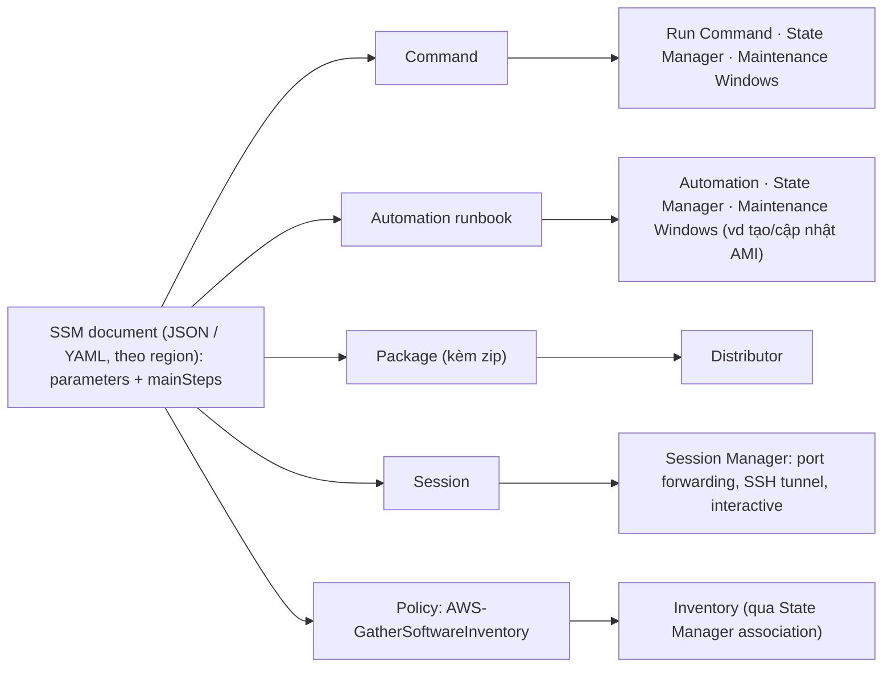

# SSM Documents

> **TL;DR:** SSM document là file **JSON hoặc YAML**, về khái niệm **giống template CloudFormation**, được Systems Manager **lưu theo region** và dùng chung cho nhiều tính năng. Document **nhận parameter** và thường có **các bước** (`mainSteps`) để làm, kiểm tra hoặc cấu hình. Năm loại cần nhận ra: **Command** (Run Command, State Manager, Maintenance Windows), **Automation runbook** (Automation, State Manager, Maintenance Windows), **Package** (Distributor), **Session** (Session Manager) và **Policy** (Inventory). Đề thi **không yêu cầu viết document**, chỉ cần biết loại nào phục vụ tính năng nào.

## 🖼️ Sơ đồ
![[SSM Documents.excalidraw]]
*Mở bằng plugin Excalidraw để chỉnh sửa · ảnh tĩnh: [[SSM Documents.svg]]*

## Khái niệm cốt lõi
- **Định dạng**: JSON hoặc YAML. Giống [[CloudFormation Basics|template CloudFormation]] về cấu trúc, nhưng Systems Manager dùng chúng để **làm việc, cấu hình hoặc đảm bảo compliance**.
- **Lưu theo region** trong Systems Manager và được nhiều tính năng của Systems Manager dùng chung.
- Document có thể **hỏi parameter** và thường có **các bước** (steps) cần làm, kiểm tra hoặc cấu hình.
- **Các loại document**:
  - **Command document**: dùng bởi
    - **Run Command**: chạy lệnh (xem [[SSM Run Command]]).
    - **State Manager**: áp một cấu hình, một lần hoặc nhiều lần, lên một hay nhiều target **ở bất kỳ thời điểm nào trong vòng đời** của managed node; dùng được cho **desired state configuration**.
    - **Maintenance Windows**: áp cấu hình **theo lịch**.
  - **Automation runbook**: dùng bởi **Automation**, **State Manager** và **Maintenance Windows**. Dùng cho các việc bảo trì và triển khai thường gặp, ví dụ **tạo hoặc cập nhật AMI**.
  - **Package document** (ít gặp hơn): dùng bởi **Distributor**. Package được biểu diễn bằng một SSM document có **đính kèm file zip** chứa phần mềm hay tài nguyên cần cài lên node; phân phối package thực chất là triển khai một document có payload zip.
  - **Session document**: dùng bởi **Session Manager**, định nghĩa **kiểu session**: port forwarding, SSH tunnel hoặc interactive command.
  - **Policy document**: **Inventory** dùng policy document **AWS-GatherSoftwareInventory** cùng một **State Manager association** để thu thập dữ liệu inventory.
- Mỗi loại phục vụ một mục đích rất riêng; cho đề thi chỉ cần biết **các loại này tồn tại** và hỗ trợ tính năng nào.

## Cách hoạt động / Kiến trúc

Cấu trúc nội dung một document (xem trong demo): `schemaVersion`, `description`, `parameters`, rồi phần quan trọng **`mainSteps`** mô tả việc sẽ làm. Một document có thể chứa nhiều bước cho nhiều OS, dùng **precondition** (ví dụ `platformType` = Windows) để bước PowerShell chỉ chạy trên Windows, bước Bash chỉ chạy trên Linux.

## Bảng so sánh / số liệu

| Loại document | Tính năng dùng nó | Ví dụ / ghi chú |
|---|---|---|
| **Command** | Run Command, State Manager, Maintenance Windows | Chạy shell/PowerShell, desired state, cấu hình theo lịch |
| **Automation runbook** | Automation, State Manager, Maintenance Windows | Tạo hoặc cập nhật AMI |
| **Package** | Distributor | Document đính kèm file zip phần mềm |
| **Session** | Session Manager | Port forwarding, SSH tunnel, interactive command |
| **Policy** | Inventory | AWS-GatherSoftwareInventory + State Manager association |

## Demo / Lab
1. Console → tìm **SSM** (lối tắt tới Systems Manager), region N. Virginia. Systems Manager có rất nhiều tính năng; khóa học chỉ dùng một phần.
2. **Change Management Tools → Documents**. Có các tab **Owned by Amazon**, **Owned by me**, **Shared with me** (như nhiều dịch vụ AWS khác).
3. Mở **AWS-ConfigureAWSPackage** (do Amazon quản lý, có versioning nhưng ta không xem được mọi version cũ):
   - Mô tả: **cài hoặc gỡ một Distributor package**; hỗ trợ **Windows, Linux và macOS**.
   - Tab **Details**: parameters, attachments, permissions, tags, categories. Tab **Content**: chính document dạng JSON: `schemaVersion`, `description`, `parameters` (action Install/Uninstall, installationType, name, version…), rồi **`mainSteps`** chạy một lệnh, ở đây là script **PowerShell**.
4. Mở **AmazonCloudWatch-ManageAgent**: dùng document trước để **cài package CloudWatch agent**, rồi dùng document này để **cấu hình agent** (xem [[CloudWatch Agent]]). Trong `mainSteps`, bước đầu (`ControlCloudWatchAgentWindows`) có **precondition** `platformType` = Windows và chạy PowerShell; kéo xuống có bước tương tự cho **Linux bằng Bash**.
5. Kết luận của giảng viên: không cần biết viết document, chỉ cần hiểu ở mức cao chúng là gì, cấu trúc giống CloudFormation, và cách dùng tùy tính năng Systems Manager.

## 🎯 Mẹo thi SAA-C03
- SSM document = **JSON/YAML**, **theo region**, giống template CloudFormation; có **parameters** và **steps**.
- Nhận ra loại theo tính năng: **Command** → Run Command / State Manager / Maintenance Windows; **Automation runbook** → Automation (vd **tạo/cập nhật AMI**); **Package** → **Distributor**; **Session** → **Session Manager**; **Policy** → **Inventory**.
- "Giữ cấu hình OS ở trạng thái mong muốn, tự sửa khi bị lệch" → **State Manager** + command document.
- "Cài/phân phối phần mềm (agent…) lên fleet managed node" → **Distributor** (package document), cấu hình thì chạy command document qua Run Command.
- Không cần tự viết document; dùng document **Owned by Amazon** cho việc phổ biến (vd `AWS-ConfigureAWSPackage`, `AmazonCloudWatch-ManageAgent`).

## Liên kết
- Nền tảng: [[Systems Manager]]
- Tính năng dùng document: [[SSM Run Command]], [[SSM Patch Manager]]
- Liên quan: [[CloudFormation Basics]], [[CloudWatch Agent]], [[AMI]], [[AWS Service Catalog]] (service actions dùng Systems Manager Automation), [[AWS Config]] (remediation bằng Systems Manager Automation)
- MOC: [[_MOC 22 Systems Manager]]
