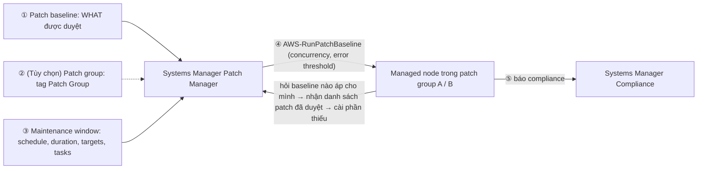

# SSM Patch Manager

> **TL;DR:** Patch Manager là tính năng của [[Systems Manager]] để **patch Windows Server, Linux, macOS, EC2, edge device, server on-prem và VM** trong môi trường hybrid. **Patch baseline** định nghĩa **patch nào được duyệt** (mỗi OS có baseline mặc định, đa số **tự duyệt sau 7 ngày**, Ubuntu và Debian duyệt ngay); **patch group** (tùy chọn, theo tag `Patch Group`) đổi baseline cho một nhóm node; **maintenance window** định nghĩa **khi nào** patch (schedule, duration, target, task); khi window chạy, Run Command **`AWS-RunPatchBaseline`** thực hiện cài đặt với **concurrency** và **error threshold**; cuối cùng **compliance** báo node nào thiếu patch.

## 🖼️ Sơ đồ
![[SSM Patch Manager.excalidraw]]
*Mở bằng plugin Excalidraw để chỉnh sửa · ảnh tĩnh: [[SSM Patch Manager.svg]]*

## Khái niệm cốt lõi
- **Patch Manager** patch được Windows Server, Linux, macOS, EC2, edge device, server on-prem và VM trên toàn môi trường hybrid. Rất cần cho triển khai AWS lớn, nhất là hybrid.
- **Patch baseline** = **patch nào được duyệt (WHAT)**:
  - Có baseline **predefined** (do AWS cung cấp) và **custom**; mỗi hệ điều hành có baseline riêng.
  - **Mỗi OS có một default baseline**; managed node **tự dùng default của OS mình**, nên patching chạy được mà không phải gán gì.
  - Baseline là **luật duyệt**, không phải danh sách cố định: phần lớn baseline predefined có **auto-approval delay**, patch chỉ được **duyệt 7 ngày sau khi phát hành**. Đây là thời điểm **duyệt**, không phải lịch cài.
- **Patch group** (tùy chọn): nhóm managed node để **đổi baseline** được dùng. Không dùng patch group thì node dùng default baseline của OS.
  - Định nghĩa bằng **tag**, cụ thể là tag key **`Patch Group`**.
  - Một managed node **chỉ thuộc một patch group**; một patch group **chỉ đăng ký với một patch baseline cho mỗi loại OS**.
- **Maintenance window** = **khi nào (WHEN)** patch được cài, và hơn thế: định nghĩa **schedule**, **duration**, **target** (vd các patch group) và **một hay nhiều task**. Đây là "chất keo" nối mọi thứ lại; tên gọi hơi dễ hiểu lầm vì nó không chỉ là một khung giờ.
- **Patch policies**: console có wizard gói baseline, targeting và schedule vào một chỗ. Cùng khái niệm, chỉ khác cách đóng gói.
- **Run Command** là nền thực hiện: mọi thao tác patch đều do Run Command chạy phía sau trên node (xem [[SSM Run Command]]).
- **Concurrency** = số node được patch cùng lúc; **error threshold** = số lỗi tối đa trước khi cả quá trình patch dừng.
- **Compliance**: sau khi patch, Systems Manager so trạng thái thực tế với baseline: node nào đủ patch, node nào thiếu.
- **Inventory** (tiêu đề video có nhắc, nội dung video chỉ nói Patch Manager): Systems Manager thu thập ứng dụng đã cài, file, cấu hình mạng, OS patch và hotfix, phần cứng, service đang chạy (xem [[Systems Manager]]); Inventory dùng policy document `AWS-GatherSoftwareInventory` (xem [[SSM Documents]]).

### Tên các baseline predefined (nhận ra được là đủ)
- **Linux**: dạng `AWS-[OS]DefaultPatchBaseline`, **định nghĩa luật rõ ràng**, riêng cho từng OS và **từng bản phân phối Linux** (mỗi distro có repository cập nhật khác nhau):
  - `AWS-AmazonLinux2023DefaultPatchBaseline`: cho Amazon Linux 2023.
  - `AWS-UbuntuDefaultPatchBaseline`: cho Ubuntu.
- Baseline mặc định thường gồm patch **liên quan bảo mật** có mức **Critical** hoặc **Important**. Đa số **tự duyệt sau 7 ngày**; **Ubuntu và Debian là ngoại lệ, duyệt ngay**.
- **Windows**:
  - `AWS-DefaultPatchBaseline`: bản cập nhật **Critical và Security**.
  - `AWS-WindowsPredefinedPatchBaseline-OS`: giống trên.
  - `AWS-WindowsPredefinedPatchBaseline-OS-Applications`: như trên **cộng thêm patch cho ứng dụng Microsoft**.

## Cách hoạt động / Kiến trúc

1. **Định nghĩa (hoặc chọn) một hay nhiều patch baseline** = cái gì được cài. Fleet có nhiều phiên bản Linux và Windows thì sẽ có nhiều baseline.
2. **(Tùy chọn) Tạo patch group** bằng tag `Patch Group`; patch group làm target cho các task patch.
3. **Tạo maintenance window** = khi nào: schedule, duration, target (patch group) và task.
4. Khi maintenance window kích hoạt, Run Command **`AWS-RunPatchBaseline`** chạy trên các node target, mang theo các thiết lập khác của window.
   - Điểm ít hiển nhiên: Run Command **không chỉ định baseline** cho node. **Mỗi node tự hỏi Patch Manager** baseline nào áp cho mình: baseline đăng ký với patch group của nó, hoặc default baseline của OS.
   - Node nhận về **danh sách patch đã duyệt**, rồi **tải và cài những patch còn thiếu** qua SSM Agent.
5. **Compliance**: dữ liệu compliance sinh ra trên từng node trong lúc patch và được báo về Patch Manager → thấy theo từng node patch nào đã cài, patch nào còn thiếu.

## Bảng so sánh / số liệu

| Thành phần | Trả lời câu hỏi | Ghi nhớ |
|---|---|---|
| Patch baseline | **Patch nào** được duyệt | Default theo OS; auto-approve 7 ngày (Ubuntu, Debian: ngay) |
| Patch group | **Nhóm node nào** dùng baseline nào | Tag `Patch Group`; 1 node ↔ 1 group; 1 group ↔ 1 baseline mỗi loại OS |
| Maintenance window | **Khi nào** và **làm gì** | Schedule, duration, targets, tasks |
| `AWS-RunPatchBaseline` | **Ai cài** | Run Command; node tự hỏi baseline của mình |
| Concurrency / error threshold | Cài **bao nhiêu node một lúc**, dừng khi nào | Như rate control của Run Command |
| Compliance | **Đã đủ patch chưa** | Báo theo từng node |

| Baseline predefined | Dành cho |
|---|---|
| `AWS-AmazonLinux2023DefaultPatchBaseline` | Amazon Linux 2023 |
| `AWS-UbuntuDefaultPatchBaseline` | Ubuntu |
| `AWS-DefaultPatchBaseline` | Windows: Critical + Security |
| `AWS-WindowsPredefinedPatchBaseline-OS` | Windows: như trên |
| `AWS-WindowsPredefinedPatchBaseline-OS-Applications` | Windows: như trên + ứng dụng Microsoft |

## 🎯 Mẹo thi SAA-C03
- "Tự động patch fleet EC2 **và server on-prem** theo lịch, có kiểm soát, báo cáo compliance" → **Systems Manager Patch Manager**.
- **Baseline = WHAT**, **maintenance window = WHEN**, **Run Command `AWS-RunPatchBaseline` = thực hiện**, **compliance = kiểm tra kết quả**.
- Nhóm node cần baseline khác default → **patch group** (tag key `Patch Group`); một node chỉ ở **một** patch group.
- Không gán gì vẫn patch được: node dùng **default baseline của OS**.
- Patch chưa cài dù đã phát hành: nhớ **auto-approval delay 7 ngày** của đa số baseline predefined (Ubuntu, Debian duyệt ngay).
- Cần cả patch **ứng dụng Microsoft** trên Windows → `AWS-WindowsPredefinedPatchBaseline-OS-Applications`.
- Patch từng phần fleet để tránh sự cố hàng loạt → **concurrency** và **error threshold**.

## Liên kết
- Nền tảng: [[Systems Manager]], [[SSM Run Command]], [[SSM Documents]]
- Liên quan: [[AWS Config]] (compliance cấu hình resource), [[Inspector]] (đánh giá lỗ hổng)
- MOC: [[_MOC 22 Systems Manager]]
