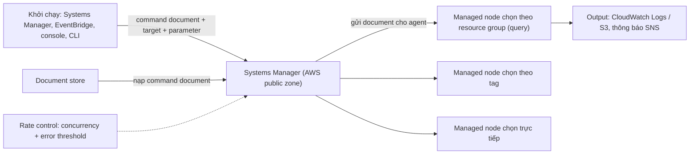

# SSM Run Command

> **TL;DR:** Run Command là tính năng của [[Systems Manager]] để **chạy lệnh trên managed node mà không cần SSH hay RDP**. Lấy một **command document** từ document store, kèm **target** và **parameter**, gửi cho **SSM Agent** trên các node thực thi. Chọn node theo **node cụ thể, tag hoặc resource group**; kiểm soát bằng **rate control** (**concurrency** và **error threshold**); output gửi tới **CloudWatch Logs hoặc S3**, thông báo qua **SNS**; có thể là **target của EventBridge rule** (chạy theo lịch hoặc theo event). Patch Manager cũng chạy trên nền Run Command.

## 🖼️ Sơ đồ
![[SSM Run Command.excalidraw]]
*Mở bằng plugin Excalidraw để chỉnh sửa · ảnh tĩnh: [[SSM Run Command.svg]]*

## Khái niệm cốt lõi
- **Run Command** = chạy lệnh trên **managed node**. Cụ thể hơn: lấy một **command document** trong **document store** của Systems Manager rồi để **agent** trên các node thực thi nó.
- **Không cần truy cập node qua SSH hoặc RDP**: không mở port, không cần key, không cần bastion.
- **Command document** (xem [[SSM Documents]]):
  - Định nghĩa **các bước** của lệnh, **dùng lại được** và **nhận parameter**.
  - Có thể đơn giản (chạy một shell command, join máy vào domain) hoặc phức tạp (dựng cả một domain controller). Định nghĩa được gì thì đưa vào document được.
- **Chọn node chạy lệnh**, ba cách thường gặp:
  - Chọn **node cụ thể**.
  - Theo **tag** gắn trên node.
  - Theo **resource group** tạo từ **query** định nghĩa được, chạy được trên cả hạ tầng AWS lẫn on-prem.
- **Rate control** khi chạy trên nhiều node:
  - **Concurrency**: chạy trên **bao nhiêu node cùng lúc**.
  - **Error threshold**: **bao nhiêu lệnh lỗi** trên từng node thì **cả command bị coi là thất bại**.
- **Output** gửi tới **[[CloudWatch Logs]]** hoặc **S3**; hệ thống có thể gửi **thông báo tới [[SNS]]**.
- **Tích hợp [[EventBridge]]**: Run Command làm **target của EventBridge rule** → chạy lệnh **theo lịch** hoặc **phản ứng với một event** trong account ("có gì xảy ra thì làm gì đó").
- **Nền cho tính năng khác**: các tính năng như **Patch Manager** dùng Run Command để làm việc thật trên node (xem [[SSM Patch Manager]]).

## Cách hoạt động / Kiến trúc

1. Run Command được khởi chạy từ **Systems Manager**, **EventBridge**, **console UI** hoặc **CLI**.
2. Mỗi lần chạy gồm hai thứ: **command document + target**, cùng **parameter** cho document.
3. Systems Manager **nạp command document** từ document store để xử lý.
4. Target được chọn bằng **resource group (query)**, **tag** hoặc **chọn trực tiếp** node; mọi node đều có **SSM Agent**.
5. Systems Manager **gửi document tới agent** trên từng node; agent thực thi lệnh.
6. **Concurrency** quyết định số node chạy cùng lúc; **error threshold** quyết định số lỗi tối đa trước khi job thất bại.

## Bảng so sánh / số liệu

| Thiết lập | Ý nghĩa |
|---|---|
| Target | Node cụ thể, tag, resource group (query) |
| Concurrency | Số node chạy lệnh cùng lúc |
| Error threshold | Số lệnh lỗi tối đa trước khi cả command thất bại |
| Output | CloudWatch Logs hoặc S3 |
| Thông báo | SNS |
| Kích hoạt | Console, CLI, Systems Manager, EventBridge (lịch hoặc event) |

| Cách chạy lệnh trên fleet | Nhược điểm / ưu điểm |
|---|---|
| SSH/RDP từng máy | Phải mở port, phân phối key, làm tay |
| [[EC2 User Data Bootstrapping\|User data]] | Chỉ chạy lúc launch |
| **Run Command** | Chạy bất kỳ lúc nào, trên nhiều node, có rate control, không SSH/RDP |

## 🎯 Mẹo thi SAA-C03
- Giảng viên: Run Command **xuất hiện trong đề rất thường xuyên**.
- "Chạy script/lệnh trên **nhiều EC2 và server on-prem** cùng lúc, **không SSH/RDP, không mở port inbound**" → **Run Command**.
- "Chạy lệnh **theo lịch** hoặc **khi có event** trong account" → **EventBridge rule với target là Run Command**.
- "Giới hạn số máy chạy cùng lúc / dừng khi quá nhiều lỗi" → **concurrency / error threshold** (rate control).
- Lưu output lệnh → **CloudWatch Logs** hoặc **S3**; báo trạng thái → **SNS**.
- Patch Manager thực chất chạy **Run Command** `AWS-RunPatchBaseline` trên node.

## Liên kết
- Nền tảng: [[Systems Manager]], [[SSM Documents]]
- Dùng Run Command: [[SSM Patch Manager]], [[CloudWatch Agent]] (cài agent cho cả fleet)
- Liên quan: [[EventBridge]], [[CloudWatch Logs]], [[SNS]], [[ASG Lifecycle Hooks]]
- MOC: [[_MOC 22 Systems Manager]]
