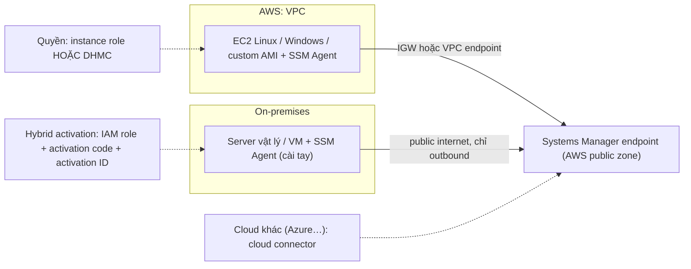

# Systems Manager

> **TL;DR:** AWS Systems Manager (tên cũ **SSM**, Simple Systems Manager) là dịch vụ **quản lý và điều khiển tập trung** cho máy chủ ở **AWS, on-premises và cả cloud khác**. Mỗi máy cần **SSM Agent**, **quyền** và **kết nối outbound** tới endpoint của Systems Manager (một **public service**); khi đó máy thành **managed node** (gọi là **managed instance** nếu là EC2). Trên AWS, quyền đến từ **instance role** hoặc **Default Host Management Configuration (DHMC)**; server on-prem tham gia bằng **hybrid activation** (activation code + activation ID). Tính năng chính cho đề thi: **inventory, patching, Run Command, desired state, Parameter Store, Session Manager**.

## 🖼️ Sơ đồ
![[Systems Manager.excalidraw]]
*Mở bằng plugin Excalidraw để chỉnh sửa · ảnh tĩnh: [[Systems Manager.svg]]*

## Khái niệm cốt lõi
- **Mục đích**: quản lý và điều khiển hạ tầng **ở bất kỳ đâu**: AWS, on-premises, cloud khác. Môi trường càng lớn, nhất là **hybrid**, càng cần một công cụ quản trị hệ thống tập trung như Systems Manager.
- **Agent**: mọi tính năng đều dựa vào **SSM Agent** cài trên server/instance, agent nói chuyện với **Systems Manager endpoint**.
  - Agent **cài sẵn trên hầu hết AMI hiện đại do AWS cung cấp**, cả Linux lẫn Windows (Amazon Linux, Ubuntu, Windows Server 2016 trở đi).
  - AMI cũ, AMI tự làm hoặc server on-prem: tự cài theo hướng dẫn tải về, hoặc dùng hệ thống configuration management khác.
- **Thuật ngữ**:
  - **Managed node** = mọi thứ Systems Manager quản lý: EC2, server on-prem, VM ở cloud khác.
  - **Managed instance** = managed node là **EC2 instance**.
- **Các tính năng chính** (giảng viên nhấn mạnh cho đề thi):
  - **Inventory**: thu thập thông tin từ managed node: ứng dụng đã cài, file, cấu hình mạng, OS patch và hotfix, phần cứng instance, service đang chạy, cả mục tùy chỉnh.
  - **Patching**: định nghĩa **maintenance window** và **baseline**, tự patch instance an toàn, có kiểm soát (xem [[SSM Patch Manager]]).
  - **Run Command**: chạy lệnh trên từng node hoặc cả nhóm node; muốn chạy gì đó trên một máy thì thường đây là cách dễ nhất (xem [[SSM Run Command]]).
  - **Desired state** (State Manager): định nghĩa trạng thái mong muốn, ví dụ một số port **luôn bị chặn** trên firewall của OS; nếu port bị mở lại, Systems Manager đưa cấu hình về đúng trạng thái.
  - **Parameter Store**: lưu cấu hình và secret (xem [[SSM Parameter Store]]); secret có rotation thì dùng [[Secrets Manager]].
  - **Session Manager**: kết nối an toàn vào EC2, **kể cả instance trong private subnet**, và cả server on-prem được quản lý, miễn là máy có **kết nối outbound tới endpoint** của Systems Manager.
- Các tính năng trên dùng chung một loại cấu hình là **SSM document** (xem [[SSM Documents]]).

## Cách hoạt động / Kiến trúc

### Phía AWS (EC2)
1. **Agent**: có sẵn trên đa số AMI hiện tại; AMI cũ hoặc custom thì cài tay.
2. **Quyền**, hai cách:
   - **EC2 instance role** có quyền làm việc với Systems Manager (xem [[EC2 Instance Roles]]).
   - **Default Host Management Configuration (DHMC)**, cách AWS hiện khuyên dùng vì đơn giản hơn: bật **một lần cho mỗi account, mỗi region**; từ đó mọi instance có **IMDSv2** (xem [[EC2 Instance Metadata]]) và **agent bản hiện tại** tự động thành managed instance, **không cần instance role**.
3. **Kết nối mạng** tới Systems Manager endpoint: qua **Internet Gateway** hoặc **VPC endpoint** (xem [[Interface VPC Endpoints]]).
4. Đủ ba điều kiện → instance thành **managed instance**, điều khiển được qua Systems Manager.

### Phía on-premises
1. Cũng cần agent, quyền và kết nối, nhưng cách tham gia khác.
2. Server vật lý hoặc ảo nói chuyện với Systems Manager **qua public internet**; Systems Manager **chỉ cần outbound**, không cần inbound.
3. Tạo **hybrid activation**: chọn một **IAM role** mà server on-prem sẽ dùng **gián tiếp** để nhận quyền. Mỗi activation cho một **activation code** và **activation ID**.
4. Khi cấu hình agent trên server, nhập activation code và ID → thiết lập kênh liên lạc an toàn với endpoint → server hiện là **managed node** và dùng được mọi tính năng.

### Cloud khác
- AWS đang mở rộng Systems Manager sang cloud khác. Ví dụ Azure thì thường dùng **cloud connector**; chi tiết tùy từng nhà cung cấp, chỉ cần biết là có lựa chọn này.

## Bảng so sánh / số liệu

| | EC2 trên AWS | Server on-prem / VM |
|---|---|---|
| Agent | Có sẵn trên đa số AMI mới; AMI cũ/custom cài tay | Cài tay |
| Quyền | Instance role **hoặc** DHMC (không cần role) | IAM role gắn với **hybrid activation** |
| Đăng ký | Tự động khi đủ agent + quyền + mạng | **Activation code + activation ID** |
| Mạng tới endpoint | Internet Gateway hoặc VPC endpoint | Public internet, **chỉ outbound** |
| Tên gọi | Managed instance | Managed node |

| Cách vào instance để quản trị | Cần gì |
|---|---|
| SSH client + key pair | Port 22 inbound, key (xem [[EC2 Instance Connect and SSH]]) |
| [[Bastion Host]] | Instance public làm điểm nhảy |
| **Session Manager** | Agent + quyền + outbound tới endpoint; vào được instance private, không mở port inbound |

## 🎯 Mẹo thi SAA-C03
- "Quản lý tập trung, patch, chạy lệnh, inventory cho **fleet EC2 và server on-premises (hybrid)**" → **Systems Manager**.
- Instance **không hiện là managed instance** → kiểm tra ba thứ: **agent**, **quyền** (instance role hoặc DHMC), **đường mạng tới endpoint** (Internet Gateway hoặc VPC endpoint).
- Muốn instance tự thành managed **không cần gắn instance role** → **DHMC** (bật mỗi account, mỗi region; instance cần IMDSv2 + agent mới).
- Server **on-premises** tham gia Systems Manager → **hybrid activation** (IAM role, activation code + ID); chỉ cần **outbound**.
- Vào shell instance **private**, **không mở port inbound, không bastion** → **Session Manager**.
- Cấu hình/secret → **Parameter Store**; secret cần **rotation** → **Secrets Manager**.

## Liên kết
- Tính năng trong chương: [[SSM Run Command]], [[SSM Documents]], [[SSM Patch Manager]]
- Liên quan: [[SSM Parameter Store]], [[Secrets Manager]], [[EC2 Instance Roles]], [[EC2 Instance Metadata]], [[Interface VPC Endpoints]], [[Bastion Host]], [[EC2 Instance Connect and SSH]], [[CloudWatch Agent]]
- MOC: [[_MOC 22 Systems Manager]]
