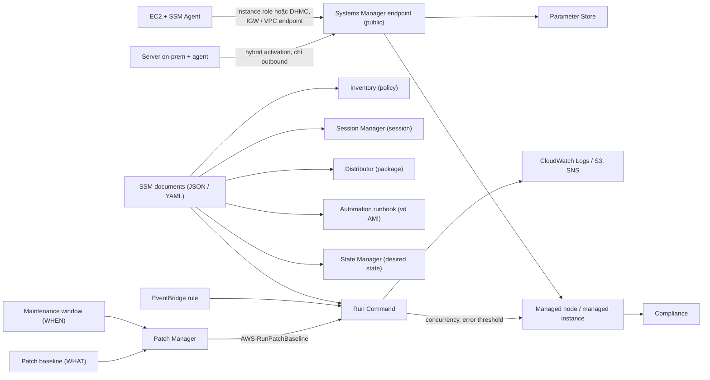

# 22 Systems Manager

Chương mới theo bản khóa mới, về AWS Systems Manager (SSM): cách EC2, server on-premises và VM ở cloud khác thành managed node (SSM Agent, instance role hoặc DHMC, hybrid activation, kết nối outbound tới endpoint), chạy lệnh trên cả fleet không cần SSH/RDP bằng Run Command, các loại SSM document mà mọi tính năng dùng chung, và patch tự động bằng Patch Manager (baseline, patch group, maintenance window, compliance). Parameter Store đã học ở [[_MOC 09 Advanced EC2]]; Session Manager xuất hiện ở các demo EC2 và VPC. Đề hỏi Systems Manager theo kiểu "quản lý fleet hybrid với ít vận hành nhất".

← [[00 Home]] · Trước: [[_MOC 21 Machine Learning]] · Sau: [[_MOC 23 Elastic Beanstalk]]

## Lộ trình học
1. [[Systems Manager]]: managed node ở AWS, on-prem, cloud khác; agent + quyền (instance role hoặc DHMC) + kết nối outbound; hybrid activation; inventory, patch, Run Command, desired state, Parameter Store, Session Manager.
2. [[SSM Run Command]]: chạy command document trên node theo node/tag/resource group, không SSH/RDP; concurrency, error threshold; output CloudWatch Logs/S3, SNS; target của EventBridge.
3. [[SSM Documents]]: JSON/YAML theo region, giống CloudFormation; Command, Automation runbook, Package, Session, Policy và tính năng dùng từng loại.
4. [[SSM Patch Manager]]: baseline (WHAT, tự duyệt sau 7 ngày), patch group (tag), maintenance window (WHEN), AWS-RunPatchBaseline, compliance.

## Bản đồ khái niệm

## Liên kết sang section khác
- Parameter Store, instance role, CloudWatch Agent: [[SSM Parameter Store]], [[EC2 Instance Roles]], [[CloudWatch Agent]]
- Truy cập instance: [[Bastion Host]], [[EC2 Instance Connect and SSH]], [[EC2 Instance Metadata]] (IMDSv2 cho DHMC)
- Mạng tới endpoint: [[Interface VPC Endpoints]]
- Tự động hóa và kích hoạt: [[EventBridge]], [[AWS Config]] (remediation bằng SSM Automation), [[AWS Service Catalog]] (service actions)

## 🎯 Top mẹo thi của section
- Quản lý tập trung fleet **EC2 + on-premises (hybrid)**: inventory, patch, chạy lệnh → **Systems Manager**. ([[Systems Manager]])
- Instance không thành managed instance → kiểm tra **agent**, **quyền** (instance role hoặc **DHMC**, không cần role, cần IMDSv2) và **đường tới endpoint** (IGW hoặc VPC endpoint). ([[Systems Manager]])
- Server on-prem → **hybrid activation** (IAM role, activation code + ID), **chỉ cần outbound**. ([[Systems Manager]])
- Vào shell instance private **không mở port inbound, không bastion** → **Session Manager**. ([[Systems Manager]])
- Chạy lệnh trên nhiều máy **không SSH/RDP** → **Run Command**; theo lịch hoặc theo event → **EventBridge target Run Command**; giới hạn chạy đồng thời → **concurrency / error threshold**. ([[SSM Run Command]])
- SSM document: Command → Run Command/State Manager/Maintenance Windows; Automation runbook → Automation (AMI); Package → Distributor; Session → Session Manager; Policy → Inventory. Không cần viết document. ([[SSM Documents]])
- Patch: **baseline = WHAT**, **maintenance window = WHEN**, **AWS-RunPatchBaseline** cài, **compliance** kiểm tra; patch group theo tag `Patch Group`, một node một group; đa số baseline tự duyệt sau **7 ngày**. ([[SSM Patch Manager]])
