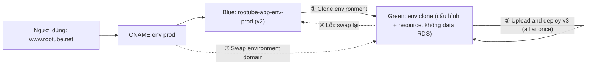

# Elastic Beanstalk Cloning and Blue-Green

> **TL;DR:** **Environment cloning** tạo environment mới bằng cách **sao chép một environment có sẵn** (option setting, environment variable, resource AWS gắn kèm…), không phải cấu hình lại từ đầu; chỉ đổi được tên, URL prefix, mô tả, **platform version (cùng platform branch)** và service role. Clone **tạo RDS** nếu environment có, nhưng **không copy dữ liệu**; **unmanaged change** không được copy. Clone + **swap environment domain (CNAME swap)** là cách làm **blue/green** trong [[Elastic Beanstalk]]: clone prod, deploy bản mới lên bản clone, test, rồi swap CNAME; lỗi thì swap lại.

## 🖼️ Sơ đồ
![[Elastic Beanstalk Cloning and Blue-Green.excalidraw]]
*Mở bằng plugin Excalidraw để chỉnh sửa · ảnh tĩnh: [[Elastic Beanstalk Cloning and Blue-Green.svg]]*

## Khái niệm cốt lõi

### Environment cloning
- Tạo **environment mới** bằng cách **clone environment có sẵn**. Ví dụ:
  - Copy **PROD-ENV** thành **TEST-ENV** giống hệt để test và QA riêng.
  - Thử **platform version mới** để kiểm tra tương thích mà không ảnh hưởng environment gốc.
- Không phải cấu hình tay option setting, environment variable và các setting khác: EB tạo **bản sao đầy đủ**, kể cả **bản sao các resource AWS** gắn với environment gốc.
- Lúc clone **đổi được**: **tên**, **URL prefix** (domain name prefix), **mô tả**, **platform version** và **service role**. Mọi thứ khác giống bản gốc; sau khi clone xong vẫn sửa cấu hình như bình thường.
- **RDS**: clone **có tạo RDS instance** đã định nghĩa trong environment, nhưng **không clone dữ liệu** từ RDS (xem [[Elastic Beanstalk and RDS]]).
- **Platform**: chỉ clone sang **platform version khác của cùng platform branch**. Platform branch khác không chắc tương thích; muốn đổi branch thì **tạo environment mới bằng tay**, deploy code, sửa code và option cho chạy đúng.
- **Unmanaged change không được copy**: thay đổi resource bằng công cụ khác ngoài console EB, EB CLI hay API của EB (ví dụ sửa trực tiếp security group) là unmanaged change. (Console còn nhắc kiểm tra **stack drift** trong CloudFormation trước khi clone; thấy trên màn hình demo.)
- Cách clone: **console** (Actions → Clone environment) hoặc EB CLI **`eb clone <tên-environment-có-sẵn>`**.
- Dùng cho: test, QA, nâng version, **blue/green deployment**.

### Blue/green với CNAME swap
- Không phải một deployment policy (xem [[Elastic Beanstalk Deployment Policies]]): không nâng instance **trong** một environment mà dùng **hai environment**.
- Khách dùng environment **blue** (bản cũ). **Clone** blue thành **green**, deploy bản mới lên green, cho beta test.
- Sẵn sàng thì **swap environment domain**: EB **đổi CNAME** của hai environment (thao tác này **sửa cấu hình DNS Route 53** do EB quản lý, mất vài phút để lan truyền). Tên miền khách dùng (vd `www.rootube.net` trỏ tới CNAME của EB) giữ nguyên nhưng giờ tới green.
- Lỗi → **swap lại**. Vì là thay đổi DNS, nên **giữ blue chạy tới khi bản ghi DNS cũ hết hạn**.
- Hợp khi đổi lớn và bản mới **không chạy song song được** với bản cũ trong cùng environment.

### Dọn dẹp và lifecycle của application version
- **Application version lifecycle policy**: tự xóa version cũ theo **tuổi** (vd 180 ngày) hoặc theo **tổng số version**, tùy chọn **xóa luôn source bundle trên S3**. Không xóa version đang deploy.
- **Xóa application** sẽ **terminate mọi environment** của nó (EC2, load balancer… do EB tạo). **Bucket S3 của EB vẫn còn**; chỉ trống nếu đã chọn xóa source bundle.

## Cách hoạt động / Kiến trúc

## Bảng so sánh / số liệu

| Khi clone | Hành vi |
|---|---|
| Option setting, environment variable, resource AWS | **Copy** |
| Tên, URL prefix, mô tả, platform version, service role | **Đổi được** |
| RDS trong environment | **Tạo RDS mới, không copy dữ liệu** |
| Platform branch khác | **Không**; tạo environment mới bằng tay |
| Unmanaged change (sửa ngoài EB) | **Không copy** |

| | Deployment policy | Blue/green (clone + CNAME swap) |
|---|---|---|
| Phạm vi | Instance **trong một** environment | **Hai** environment |
| Chuyển traffic | ELB / ASG | **DNS (CNAME)** |
| Rollback | Tùy policy | **Swap lại** |

## Demo / Lab
Demo 3 của chuỗi RooTube: phát hành **v3** bằng blue/green.
1. Environment prod đang chạy **v2**. Giả sử v3 là thay đổi lớn, không muốn dùng traffic splitting hay batch, cần environment riêng.
2. Environments → chọn prod → **Actions → Clone environment**. Tên và domain name prefix dài `rootube-app-env-brandnewenvironment`. Có thể đổi **platform branch/version** (vd nâng platform cho v3); dùng lại **service role** `aws-elasticbeanstalk-service-role` mà EB tạo. Clone.
3. Bản clone chạy giống hệt prod, có cả environment variable đã cấu hình ở demo trước.
4. Trên bản clone: **Upload and deploy** `rootube-version-3.zip`, đổi deployment policy (được copy là **traffic splitting**) sang **All at once** vì chưa có người dùng. v3 chạy trên domain dài.
5. Environment prod → **Actions → Swap environment domain**, chọn environment kia → Swap (cảnh báo: sẽ sửa cấu hình DNS **Route 53**). Domain cũ giờ ra v3, domain dài ra v2.
6. Có lỗi thì **Swap environment domain** lại.
7. **Dọn dẹp** (video cleanup): Application versions → chọn cả 3 version → Delete, tick **Delete versions from Amazon S3**. Thực tế nên đặt **Lifecycle settings** (giới hạn theo tuổi hoặc số lượng, tùy chọn xóa source bundle khỏi S3). Rồi **Actions → Delete application** (gõ tên để xác nhận) → terminate cả hai environment, EC2, load balancer. Chỉ bucket S3 của EB còn lại (đã trống).

## 🎯 Mẹo thi SAA-C03
- "Tạo environment test/QA **giống hệt prod** nhanh" → **clone environment** (`eb clone`).
- Clone **không copy dữ liệu RDS** và **không mang theo unmanaged change**; chỉ đổi được **platform version cùng branch**.
- "Phát hành bản mới **không downtime**, rollback tức thì, bản mới không chạy chung với bản cũ" → **blue/green**: clone + **swap environment URL/CNAME**.
- Sau swap **giữ environment cũ** tới khi DNS hết hạn rồi mới xóa.
- Version cũ chất đống trong S3 → **application version lifecycle policy**.

## Liên kết
- Nền tảng: [[Elastic Beanstalk]], [[Elastic Beanstalk Deployment Policies]]
- Liên quan: [[Elastic Beanstalk and RDS]], [[CNAME vs Alias]], [[R53 Weighted Routing]]
- MOC: [[_MOC 23 Elastic Beanstalk]]
