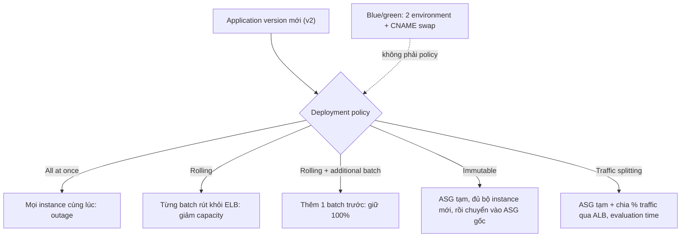

# Elastic Beanstalk Deployment Policies

> **TL;DR:** Deployment policy (= deployment type/method) quyết định cách một **application version** mới được deploy vào **environment Standard** của [[Elastic Beanstalk]]. Năm policy: **All at once** (mặc định, nhanh, có outage), **Rolling** (theo batch, giảm capacity, không tốn thêm), **Rolling with additional batch** (thêm một batch để giữ **100% capacity**, tốn thêm), **Immutable** (dựng **ASG tạm** với instance mới, rollback nhanh và an toàn nhất, tốn gấp đôi) và **Traffic splitting** (như immutable nhưng **chia % traffic** cho bản mới để **canary testing**, cần **ALB**). **Blue/green** không phải deployment policy: dùng **hai environment** + **CNAME swap**.

## 🖼️ Sơ đồ
![[Elastic Beanstalk Deployment Policies.excalidraw]]
*Mở bằng plugin Excalidraw để chỉnh sửa · ảnh tĩnh: [[Elastic Beanstalk Deployment Policies.svg]]*

## Khái niệm cốt lõi
- **All at once**:
  - Deploy version mới lên **mọi instance cùng lúc**. Đơn giản, nhanh, không có gì thông minh.
  - **Gây outage** trong lúc deploy (mọi instance offline), xử lý lỗi kém: kết quả chỉ có tất cả tốt hoặc tất cả hỏng.
  - **Mặc định** cho đa số environment tạo bằng console.
  - Lỗi thì rollback bằng **deploy lại version cũ thủ công**.
  - Dùng cho **dev/test**, không dùng cho môi trường quan trọng.
- **Rolling**:
  - Deploy theo **batch**: mỗi batch bị **rút khỏi service** (khỏi load balancer), deploy version mới, **qua health check** mới đưa lại vào service rồi sang batch tiếp.
  - An toàn hơn vì chỉ tiếp tục khi batch hiện tại healthy, nhưng **giảm capacity** đúng bằng kích thước batch; **không tăng chi phí**.
  - **Batch size** đặt được bằng **số instance** hoặc **% instance**. Ví dụ 3 instance, batch 1 → thiếu 1 instance suốt quá trình; 6 instance, batch 2 → chỉ còn 4 chạy. Batch lớn thì xong nhanh hơn nhưng thiếu nhiều instance hơn.
  - Batch lỗi → deployment **dừng**; batch đã xong chạy bản mới, phần còn lại chạy bản cũ. **Không tự rollback**: phải deploy lại version cũ.
- **Rolling with additional batch**:
  - Như rolling nhưng **thêm một batch instance mới trước** → luôn giữ **100% capacity**.
  - Ví dụ 4 instance v1, batch 2: thêm 2 instance v2 (150% capacity), rồi lần lượt nâng từng batch cũ; cuối cùng bỏ batch dư, về lại 4 instance.
  - Lâu hơn, **tốn thêm** cho instance phụ, nhưng an toàn và **hợp production**.
  - Cả rolling và rolling + batch đều có **hai version chạy cùng lúc**.
- **Immutable**:
  - Instance gốc **không bị đụng tới**. EB tạo **Auto Scaling Group tạm** với **đủ bộ instance mới** chạy version mới, phục vụ traffic song song bản cũ.
  - Qua health check → instance mới **chuyển vào ASG gốc**, instance cũ **bị terminate**, ASG tạm bị xóa.
  - **Chi phí cao** (gấp đôi instance) nhưng **rollback nhanh nhất, rủi ro thấp nhất**: tới cuối quá trình hạ tầng gốc vẫn nguyên.
- **Traffic splitting**:
  - Như immutable (ASG tạm, instance mới chạy bản mới) nhưng **chia traffic** giữa bản cũ và bản mới theo % → **canary testing**.
  - Bản mới healthy suốt **evaluation time** đặt trước → EB chuyển **toàn bộ traffic** sang; nếu không, hoặc bạn **abort**, EB trả hết traffic về bản cũ và **xóa hạ tầng mới**.
  - **Không giảm capacity**, rủi ro thấp, linh hoạt khi test, nhưng **tốn thêm** cho hạ tầng phụ.
  - **Bắt buộc có Application Load Balancer** (environment load balanced, không phải single instance).
  - Thực tế có thể bắt đầu với **10%** traffic sang bản mới để chỉ một phần người dùng bị ảnh hưởng nếu lỗi.
- **Blue/green** (không phải deployment policy): dùng **hai environment**; clone environment prod (blue) sang environment mới (green), deploy bản mới, cho beta test, rồi **swap CNAME** của hai environment. Lỗi thì swap lại; vì là thay đổi DNS nên **giữ blue chạy tới khi DNS cũ hết hạn**. Hợp khi bản mới **không thể chạy song song** bản cũ trong cùng environment (xem [[Elastic Beanstalk Cloning and Blue-Green]]).

## Cách hoạt động / Kiến trúc

## Bảng so sánh / số liệu

| Policy | Capacity khi deploy | Chi phí thêm | Downtime | Rollback | Dùng khi |
|---|---|---|---|---|---|
| **All at once** (mặc định) | Mất hết | Không | **Có** | Deploy lại thủ công | Dev/test |
| **Rolling** | Giảm theo batch | Không | Không (giảm capacity) | Deploy lại version cũ | Chịu được thiếu capacity |
| **Rolling + additional batch** | Giữ 100% | Thêm 1 batch | Không | Deploy lại version cũ | Production có tải thật |
| **Immutable** | Giữ 100% (gấp đôi tạm thời) | Cao (gấp đôi) | Không | **Nhanh, an toàn nhất** | Production, ưu tiên an toàn |
| **Traffic splitting** | Giữ 100% | Cao | Không | Nhanh, tự động nếu unhealthy | **Canary testing**; cần ALB |
| *Blue/green* (không phải policy) | 2 environment | Cao | Không | Swap CNAME lại | Bản mới không chạy chung được với bản cũ |

## Demo / Lab
Demo 2 của chuỗi RooTube: đưa **v2** ra bằng **traffic splitting**.
1. Environment prod đang chạy v1 (tab Home, Upload). **Configuration → Edit**.
2. Kiểm tra **Scaling**: traffic splitting cần **Application Load Balancer**; environment single instance mặc định thì không làm được. Ở đây load balanced min 2 / max 2. Có thể **manually configure scaling triggers** (mặc định scale theo CPU, memory, request count, response time).
3. Mục **Deployments → Deployment policy**: All at once, Rolling, Rolling with additional batch, Immutable, Traffic splitting (nút **Info** có tóm tắt). Chọn **Traffic splitting**, **50%** traffic sang version mới, **evaluation time 3 phút**. Apply (đổi cấu hình cũng là một deployment; có thể **Abort current operation**).
4. **Upload and deploy** `rootube-version-2.zip` (refresh trang trước để thấy đúng policy). Tab **Deployments** → chi tiết: tạo **ASG tạm** và hai instance test, "routed 50% of client traffic to the new application version".
5. Refresh app: lúc v1, lúc v2 (thêm tab). Qua health check và hết 3 phút đánh giá → EB đưa v2 thành bản chính, instance cũ bị terminate; refresh chỉ còn v2.
6. Ý chính: developer không tự đẩy code lên EC2, không dựng load balancer hay ASG; EB lo tạo, cấu hình, health check và xóa hạ tầng tạm.

## 🎯 Mẹo thi SAA-C03
- "Nhanh nhất, chấp nhận downtime, môi trường dev" → **All at once**.
- "Không tốn thêm chi phí, chấp nhận giảm capacity" → **Rolling**.
- "Giữ **nguyên capacity** khi deploy, tốn thêm ít" → **Rolling with additional batch**.
- "Rollback **nhanh và an toàn nhất**, không đụng instance đang chạy" → **Immutable**.
- "Đưa **X% traffic** sang bản mới để **canary test**, tự quay lại nếu lỗi" → **Traffic splitting** (cần **ALB**).
- "Bản mới **không chạy chung** được với bản cũ / thay đổi lớn" → **blue/green** với **CNAME swap** (không phải deployment policy).
- Rolling và rolling + batch: **hai version chạy cùng lúc** trong lúc deploy; không tự rollback.

## Liên kết
- Nền tảng: [[Elastic Beanstalk]]
- Tiếp theo: [[Elastic Beanstalk Cloning and Blue-Green]]
- Hạ tầng liên quan: [[Auto Scaling Groups]], [[Elastic Load Balancer]], [[ASG Health Checks]]
- Cùng ý tưởng canary ở tầng khác: [[R53 Weighted Routing]], [[API Gateway]]
- MOC: [[_MOC 23 Elastic Beanstalk]]
