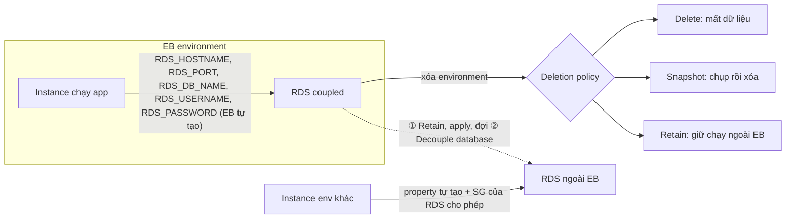

# Elastic Beanstalk and RDS

> **TL;DR:** Dùng RDS với [[Elastic Beanstalk]] có hai cách. **RDS trong environment**: RDS **gắn với vòng đời environment**; xóa environment thì DB xử lý theo **database deletion policy** (**Delete** = mất dữ liệu, **Snapshot** = chụp rồi xóa, **Retain** = giữ DB chạy ngoài EB); mỗi environment có DB và dữ liệu riêng; EB tự cấp environment property `RDS_HOSTNAME`, `RDS_PORT`, `RDS_DB_NAME`, `RDS_USERNAME`, `RDS_PASSWORD`. Chỉ nên dùng cho **dev/test nhỏ**. **RDS ngoài EB**: an toàn hơn (vòng đời tách riêng) nhưng phải **tự tạo environment property** và **mở security group** của RDS cho instance của environment. **Tách RDS đang gắn ra**: đặt deletion policy = **Retain**, apply và **đợi xong**, rồi mới **Decouple database**.

## 🖼️ Sơ đồ
![[Elastic Beanstalk and RDS.excalidraw]]
*Mở bằng plugin Excalidraw để chỉnh sửa · ảnh tĩnh: [[Elastic Beanstalk and RDS.svg]]*

## Khái niệm cốt lõi

### Cách 1: RDS bên trong environment (coupled)
- Tạo RDS instance **ngay trong environment** EB → DB **gắn với environment đó**.
- Xóa environment → DB xử lý theo **database deletion policy**, ba lựa chọn:
  - **Delete**: xóa instance → **mất dữ liệu**.
  - **Snapshot**: chụp **snapshot** trước rồi mới xóa RDS instance.
  - **Retain**: giữ instance **chạy tiếp bên ngoài** EB.
- Hệ quả: **mỗi environment một DB riêng, dữ liệu riêng** → cẩn thận khi clone hay swap (xem [[Elastic Beanstalk Cloning and Blue-Green]]). Thường chỉ dùng cho **dev/test quy mô nhỏ**.
- EB tự tạo **environment property** cho code trong environment dùng để kết nối DB: `RDS_HOSTNAME`, `RDS_PORT`, `RDS_DB_NAME`, `RDS_USERNAME`, `RDS_PASSWORD`.

### Cách 2: RDS bên ngoài EB (decoupled)
- Tạo RDS **ngoài Elastic Beanstalk**, rồi:
  - **Tự tạo** các environment property trên (host name, port, DB name, username, password) trỏ tới RDS.
  - **Cho phép instance của environment** đi qua **security group của RDS** (xem [[RDS Security]], [[Security Groups]]).
- **An toàn hơn**: thay đổi environment không đụng tới DB; RDS thường có **vòng đời khác** environment. Đổi lại phải tự quản lý property và RDS.

### Tách (decouple) RDS đang gắn với environment
1. Trong **Configuration → Database** của environment, đặt **database deletion policy = Retain**.
2. **Apply** và **đợi** thay đổi hoàn tất.
3. Rồi mới chọn **Decouple database** và apply.
- **Thứ tự rất quan trọng**: làm cả hai trong **một lần apply** (hoặc decouple trước khi Retain có hiệu lực) thì **policy cũ** (Delete hoặc Snapshot) đang có hiệu lực → **RDS có thể bị xóa, mất dữ liệu**.
- Khi đã Retain, decouple mất khoảng **5 phút**; **health của environment không bị ảnh hưởng**; RDS tiếp tục chạy như **DB bên ngoài**, vòng đời tách riêng.
- Sau đó giống hệt cách 2: kiểm tra **security group** của RDS cho phép instance của environment, và environment property trỏ đúng RDS, đúng username/password.

## Cách hoạt động / Kiến trúc

## Bảng so sánh / số liệu

| | RDS trong environment | RDS ngoài EB |
|---|---|---|
| Vòng đời | Gắn với environment | Tách riêng |
| Xóa environment | Theo deletion policy (Delete / Snapshot / Retain) | DB không bị ảnh hưởng |
| Environment property | **EB tự tạo** | **Tự tạo** |
| Security group | EB lo | **Tự mở** SG của RDS cho environment |
| Dữ liệu giữa các environment | Mỗi environment một DB riêng | Dùng chung một DB |
| Dùng cho | Dev/test nhỏ | Production (an toàn hơn) |

| Database deletion policy | Khi xóa environment |
|---|---|
| **Delete** | Xóa RDS, **mất dữ liệu** |
| **Snapshot** | Snapshot rồi xóa |
| **Retain** | Giữ RDS chạy ngoài EB |

## 🎯 Mẹo thi SAA-C03
- Production hoặc cần dữ liệu tồn tại độc lập với environment (blue/green, xóa environment) → **RDS tạo ngoài EB**, trỏ tới bằng environment property.
- Muốn **tách RDS đang gắn** mà không mất dữ liệu → **Retain → apply, đợi xong → Decouple database**; làm cùng một lần thì có thể **mất DB**.
- Xóa environment mà vẫn giữ dữ liệu: deletion policy **Snapshot** (chụp rồi xóa) hoặc **Retain** (giữ instance).
- RDS ngoài EB không kết nối được → kiểm tra **security group** của RDS và environment property.
- Clone environment có RDS → RDS mới **không có dữ liệu**.

## Liên kết
- Nền tảng: [[Elastic Beanstalk]], [[RDS Architecture]]
- Liên quan: [[CFN Deletion Policy]] (cùng ba lựa chọn Delete / Retain / Snapshot ở CloudFormation), [[RDS Security]], [[Security Groups]], [[Elastic Beanstalk Cloning and Blue-Green]], [[Secrets Manager]]
- MOC: [[_MOC 23 Elastic Beanstalk]]
