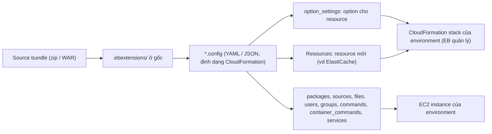

# Elastic Beanstalk ebextensions

> **TL;DR:** `.ebextensions` là cách **tùy biến environment Standard** của [[Elastic Beanstalk]] (không áp dụng cho cluster mode). Vì EB quản lý **CloudFormation stack** của environment thay bạn, muốn chỉnh stack đó thì đặt thư mục **`.ebextensions`** ở **gốc source bundle** (zip/WAR), trong đó các file **YAML hoặc JSON** đuôi **`.config`** viết theo **định dạng CloudFormation**. Dùng **`option_settings`** để đặt option cho resource, **`Resources`** để tạo **resource hoàn toàn mới** (vd ElastiCache), và các mục kiểu cfn-init: **packages, sources, files, users, groups, commands, container_commands, services**.

## 🖼️ Sơ đồ
![[Elastic Beanstalk ebextensions.excalidraw]]
*Mở bằng plugin Excalidraw để chỉnh sửa · ảnh tĩnh: [[Elastic Beanstalk ebextensions.svg]]*

## Khái niệm cốt lõi
- EB quản lý load balancer, EC2… bằng **CloudFormation** phía sau. Muốn **nhiều hơn mặc định** của EB thì tùy biến chính stack CloudFormation đó.
- Ta **không quản lý CloudFormation trực tiếp** (EB làm), nên phải dùng tính năng riêng của EB: **`.ebextensions`**, chỉ cho **Standard** (không phải cluster mode).
- **Vị trí**: thư mục `.ebextensions` ở **gốc** **application source bundle** (file zip hoặc WAR của application version).
- **File**: mọi file **JSON hoặc YAML** có đuôi **`.config`** trong thư mục đó là file cấu hình ebextensions.
- **Định dạng CloudFormation**: file `.config` dùng định nghĩa CloudFormation để tác động lên cấu hình environment.
- **Các phần chính**:
  - **`option_settings`**: đặt option cho resource.
  - **`Resources`**: tạo **resource hoàn toàn mới**, ví dụ dựng **[[ElastiCache]]** dùng cùng environment.
  - Các mục giống **cfn-init** (xem [[cfn-init]]): **packages, sources, files, users, groups, commands, container_commands, services** → tạo file, tải tài nguyên, chạy lệnh trên instance, tạo user và group…
- Vì nằm cùng code, cấu hình hạ tầng được **version và deploy cùng ứng dụng**.

## Cách hoạt động / Kiến trúc

## Bảng so sánh / số liệu

| Mục trong `.config` | Tác dụng |
|---|---|
| `option_settings` | Đặt option cho resource của environment |
| `Resources` | Tạo resource mới (vd ElastiCache) |
| `packages`, `sources`, `files` | Cài gói, tải tài nguyên, tạo file |
| `users`, `groups` | Tạo user, group trên instance |
| `commands`, `container_commands` | Chạy lệnh trên instance |
| `services` | Quản lý service |

| Mức kiểm soát | Cách |
|---|---|
| Tick/đổi setting | Configuration của environment (Standard và Cluster) |
| Tùy biến sâu, cùng version với code | **`.ebextensions`** (chỉ Standard) |
| Toàn quyền | Tự viết **CloudFormation** |

## 🎯 Mẹo thi SAA-C03
- "Tùy biến environment Elastic Beanstalk / thêm resource (vd ElastiCache) **cùng với code**" → **`.ebextensions`**.
- Nhớ vị trí: thư mục **`.ebextensions` ở gốc source bundle**, file đuôi **`.config`** (YAML/JSON), **định dạng CloudFormation**.
- `option_settings` = chỉnh option; `Resources` = resource mới.
- Chỉ cho **EB Standard**, không cho cluster mode.

## Liên kết
- Nền tảng: [[Elastic Beanstalk]], [[CloudFormation Basics]]
- Liên quan: [[cfn-init]], [[ElastiCache]]
- MOC: [[_MOC 23 Elastic Beanstalk]]
