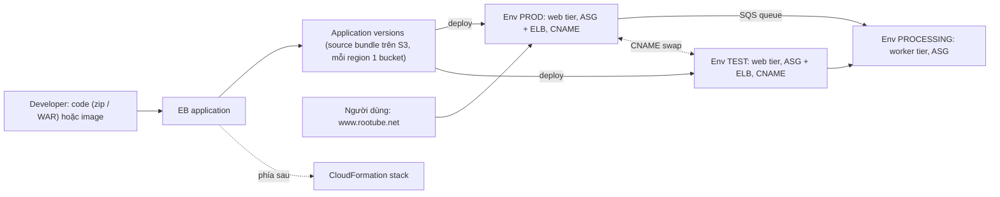

# Elastic Beanstalk

> **TL;DR:** Elastic Beanstalk (EB) là **Platform as a Service (PaaS) dành cho developer** (không phải cho end user): developer **chỉ đưa code**, EB lo **dựng và quản lý môi trường** end-to-end và deploy ứng dụng, phía sau dùng **CloudFormation**. Có hai chế độ: **Standard** (app chạy trên **EC2 trong Auto Scaling Group**, thường sau load balancer; chọn **platform**: ngôn ngữ hỗ trợ sẵn hoặc Docker; có **web tier / worker tier** với SQS) và **Cluster** (app chạy thành **container trên EKS** do EB quản lý, có ALB tùy chọn, không có platform và tier). Cấu trúc: **application** (thư mục chứa mọi thứ) → **application version** (code có nhãn; ở Standard là **source bundle** zip/WAR trong **S3**) → **environment** (hạ tầng chạy một version). Mỗi web environment có **CNAME** riêng; **CNAME swap** giữa hai environment cho **blue/green**. Database nên **để ngoài** EB.

## 🖼️ Sơ đồ
![[Elastic Beanstalk.excalidraw]]
*Mở bằng plugin Excalidraw để chỉnh sửa · ảnh tĩnh: [[Elastic Beanstalk.svg]]*

## Khái niệm cốt lõi
- **Developer-focused PaaS**: giúp developer host ứng dụng mà **không lo hạ tầng**. Từ khóa quan trọng là *developer*: nếu hỏi người dùng cuối có nên dùng EB để host một ứng dụng đóng gói sẵn (off-the-shelf) không, câu trả lời là **không**, EB không dành cho việc đó.
- **Bạn đưa code, EB quản lý môi trường**: EB cung cấp **managed application environment**, lo provisioning, quản lý và deploy ứng dụng lên môi trường.
- **Phía sau EB dùng [[CloudFormation Basics|CloudFormation]]** thay bạn: không phải viết template hay quản lý stack. Vẫn chỉnh được hạ tầng bằng cách tick, đổi setting: số EC2 (hoặc số replica ở cluster mode), luật scaling, một instance hay load balanced.
- **Tùy biến**: chỉnh environment setting (cả Standard và Cluster), hoặc ở **Standard** thêm file cấu hình trong thư mục **`.ebextensions`** đi cùng code để đổi setting hay tạo thêm resource; cấu hình hạ tầng được version và deploy cùng ứng dụng (xem [[Elastic Beanstalk ebextensions]]). Muốn **toàn quyền** thì tự dùng CloudFormation.

### Hai chế độ triển khai
- **Standard** ("EB cổ điển"):
  - App chạy **trực tiếp trên EC2** trong **Auto Scaling Group**, thường (không phải luôn) sau **load balancer**; có hỗ trợ **SQS queue** nếu app cần background worker.
  - Phải dùng **ngôn ngữ được hỗ trợ** hoặc **Docker** cho ngôn ngữ khác, và đóng gói app theo cách EB hiểu.
  - Với nhiều web app, dùng EB Standard **sửa code rất ít hoặc không phải sửa**, nhưng không phải app nào cũng chạy được nguyên trạng.
- **Cluster**:
  - App chạy thành **container**: đưa **container image**, hoặc đưa source code để EB build thành image; image chạy trên **EKS cluster** do EB tạo và vận hành, kèm **Application Load Balancer tùy chọn**.
  - So với tự quản lý [[EKS]], cluster mode đơn giản hóa việc có tính năng điều phối container mà **không phải học Kubernetes** hay tự dựng EKS.
- Dù chế độ nào, hạ tầng (cluster, EC2, load balancer, scaling group) đều do EB tạo và quản lý.

### Platform (chỉ Standard)
- **Platform** = nơi app chạy: **OS + runtime ngôn ngữ + các thành phần EB** do AWS quản lý. Chỉ Standard phải chọn, vì Cluster chạy container (image đã chứa mọi thứ).
- Hai nhóm chính (không cần nhớ từng ngôn ngữ):
  - **Ngôn ngữ hỗ trợ sẵn**: Go, Java SE, Tomcat, .NET (Core trên Linux, .NET trên Windows), Node.js, PHP, Python, Ruby. Chọn đúng platform rồi upload app.
  - **Docker**: cho mọi thứ không được hỗ trợ sẵn; đóng gói app thành Docker image, EB chạy trên EC2. Có thể **một container** hoặc **nhiều container** (Docker Compose, theo slide).

### Kiến trúc Standard
- **Application**: không phải code, mà là **container/thư mục cho mọi thứ liên quan tới ứng dụng**: code, cấu hình, cả hạ tầng.
- **Application version**: **phiên bản code có nhãn** (vd RooTube 1.1, 1.2… 1.3.3.7). Ở Standard gọi là **source bundle**, lưu ở **S3** dạng **zip hoặc WAR**, trong một **bucket EB tạo cho account, mỗi region một bucket**. Thấy "source bundle" trong đề thì gần như chắc là Elastic Beanstalk.
- **Environment**: hạ tầng nơi một application version được deploy (vd prod, test, processing). Khi tạo phải chọn **platform**; với Standard còn chọn **environment tier**:
  - **Web server tier** (mặc định): giao tiếp với end user, nhận kết nối qua **Elastic Load Balancer**, trải instance qua nhiều AZ.
  - **Worker tier**: xử lý việc từ web tier (vd xử lý thiết kế áo của Aus-E-Mart, encode hay resize video của RooTube).
  - Mọi environment đều có **Auto Scaling Group**, scale theo luật cấu hình sẵn (đổi được: network traffic, CPU, request count, latency).
  - Web tier đặt message vào **SQS queue do EB quản lý**, worker tier xử lý message; mỗi tier scale độc lập.
- Mỗi environment chạy **một version tại một thời điểm**; version nào cũng deploy tự do được lên các environment.
- **CNAME**: EB cấp cho **mỗi web environment một CNAME** dạng `…elasticbeanstalk.com`; worker không cần. Thực tế bạn trỏ tên miền riêng (vd `www.rootube.net`) vào environment muốn dùng.
- **CNAME swap**: deploy version mới lên environment khác (green), cho một nhóm người dùng beta test, rồi **đổi CNAME của hai environment**. Tên miền khách dùng không đổi, không cập nhật tại chỗ, không downtime; lỗi thì **swap lại**; ổn và DNS đã lắng thì xóa environment cũ. EB còn cho **clone environment** (xem [[Elastic Beanstalk Cloning and Blue-Green]]).

### Kiến trúc Cluster
- Vẫn có **application**, **application version**, **environment**; chọn chế độ ở **mức environment**.
- Version là **container image**, không phải source bundle. Ba cách:
  - Upload source code, EB tự build image.
  - Upload source code **kèm Dockerfile** của bạn.
  - Trỏ tới image có sẵn ở registry khác: **[[ECR]]** (private) hoặc registry public.
- **Không chọn platform**; vẫn đặt **luật scaling** theo environment: **số replica tối thiểu và tối đa**.
- **Không có tier** (web/worker) và **không có SQS queue**: mọi environment là container chạy thành một hay nhiều replica. Cần kiểu web/worker thì dùng **giao tiếp service-to-service trong EKS cluster** (phải cho phép, vì mặc định các environment **cô lập** nhau) hoặc tự quản lý SQS queue.
- Thực tế: environment không nhất thiết nằm chung một cluster, tùy cấu hình mạng (không cần cho đề).
- **ALB tùy chọn theo từng environment**: ALB ở subnet có Internet thì public; chỉ subnet private thì kết nối private. Có ALB thì vẫn có **CNAME** và vẫn làm **blue/green bằng CNAME swap**.

### Cân nhắc khi dùng
- Rất hợp với **team phát triển nhỏ**, không có team hạ tầng, muốn deploy app mà không quản lý server.
- Hợp nhất với **web app tiêu chuẩn**, chạy trên AWS với **ít thay đổi**.
- Đề muốn **microservices thuần** hoặc **hoàn toàn serverless** → thường không phải EB, mà là [[ECS]]/[[EKS]] (microservices) hoặc [[Lambda]] (serverless).
- **Standard**: mỗi environment có **hạ tầng riêng**, ổn khi ít environment. **Cluster**: các environment container **dùng chung hạ tầng** (chung EKS cluster), hợp khi cần **nhiều environment**.
- **Environment là thứ dùng xong bỏ** (clone, swap, xóa); thứ bền là **application và các version**. Vì vậy **database nên để ngoài EB** (vd RDS), environment trỏ tới qua **environment variable**. Nếu DB nằm trong environment blue thì green phải có DB riêng, swap xong dữ liệu khách hàng nằm sai chỗ (xem [[Elastic Beanstalk and RDS]]).

## Cách hoạt động / Kiến trúc

## Bảng so sánh / số liệu

| | **Standard** | **Cluster** |
|---|---|---|
| App chạy trên | EC2 trong Auto Scaling Group | Container trên EKS (EB quản lý) |
| Application version | **Source bundle** zip/WAR trên S3 | **Container image** (EB build, Dockerfile, hoặc ECR/registry) |
| Chọn platform | Có (ngôn ngữ sẵn hoặc Docker) | Không |
| Tier | Web server / worker (+ SQS do EB quản lý) | Không có; dùng giao tiếp trong cluster hoặc tự quản SQS |
| Scaling | ASG, luật scaling | Số replica min/max |
| Load balancer | ELB (tùy cấu hình) | ALB tùy chọn theo environment |
| Hạ tầng | Mỗi environment riêng | Các environment dùng chung |
| `.ebextensions` | Có | Không |
| CNAME / CNAME swap | Có | Có (khi có ALB) |

## Demo / Lab
Demo 1 của chuỗi RooTube (region N. Virginia, user IAM admin, account general):
1. Elastic Beanstalk → **Applications → Create application** `rootube-app` (container cha).
2. **Application versions → Create**: chọn nguồn **source bundle** (Standard); các lựa chọn khác là **image** hoặc **existing container image** cho cluster mode. Upload `rootube-version-1.zip` → EB tạo **bucket S3 của EB** cho account/region nếu chưa có.
3. **Create environment** → chọn **Deployment mode: Standard** (Cluster là các container chạy trên EKS). Tên `rootube-app-env-prod`; **domain name prefix** để trống thì EB tự đặt, quyết định URL `…elasticbeanstalk.com`.
4. Platform: **Python** (danh sách có .NET Core trên Linux, Windows, Docker, Go… tới Tomcat), platform branch theo hướng dẫn; Application code: **Existing version** = version 1 (khác: sample app, upload file, S3 URL). Create, đợi vài phút.
5. Mở domain → RooTube chạy. Tab **Events** (EC2, Elastic IP cho bản ghi CNAME…), **Deployments**, **Health & monitoring** (enhanced instance health), **Logs** (bật streaming sang CloudWatch Logs nếu cần), **Managed updates** (cập nhật platform do AWS quản lý).
6. **Configuration → Edit**: không đổi được application name, environment name, domain prefix, **platform** và **tier** (web/worker chỉ chọn lúc tạo). Đổi được: thêm **environment property** (plain text, hoặc tham chiếu **Secrets Manager / Parameter Store**), ví dụ `ROOTUBE_ENV`; đổi **Single instance → Load balanced** min 2 / max 2 (dùng **ALB**), instance type (t3.micro, t3.small), volume, VPC/subnet, load balancer public hay internal. Apply → một deployment mới.
7. Kết quả: app chạy **load balanced, multi-AZ**; refresh thấy đổi instance. Trong EC2 có 2 instance và 1 ALB do EB quản lý; S3 có bucket `elasticbeanstalk-<region>-<account>` chứa zip version 1; **CloudFormation** có stack do environment quản lý.

## 🎯 Mẹo thi SAA-C03
- "Developer muốn deploy **web app** nhanh, **không quản lý hạ tầng**, ít sửa code, team nhỏ không có team hạ tầng" → **Elastic Beanstalk**.
- EB **không** dành cho end user host ứng dụng đóng gói sẵn; **microservices / serverless thuần** → ECS/EKS/Lambda, không phải EB.
- Thấy **"source bundle"** → Elastic Beanstalk (zip/WAR trên S3, mỗi region một bucket).
- Ngôn ngữ không được hỗ trợ sẵn → **Docker platform**. Muốn container trên Kubernetes mà không tự vận hành EKS → **EB cluster mode**.
- Việc nền/xử lý lâu tách khỏi web → **worker tier** + SQS (chỉ Standard).
- Đổi phiên bản không downtime bằng hai environment → **CNAME swap** (blue/green); lỗi thì swap lại.
- **Database để ngoài environment** (RDS), trỏ tới bằng environment variable.
- EB dùng **CloudFormation** phía sau; tùy biến sâu ở Standard → **`.ebextensions`**.

## Liên kết
- Trong chương: [[Elastic Beanstalk Deployment Policies]], [[Elastic Beanstalk Cloning and Blue-Green]], [[Elastic Beanstalk and RDS]], [[Elastic Beanstalk ebextensions]]
- Hạ tầng EB dựng thay bạn: [[Auto Scaling Groups]], [[Elastic Load Balancer]], [[SQS]], [[EKS]], [[ECR]], [[CloudFormation Basics]]
- Liên quan: [[CNAME vs Alias]], [[Containers Fundamentals]], [[ECS]], [[Lambda]], [[SSM Parameter Store]], [[Secrets Manager]]
- MOC: [[_MOC 23 Elastic Beanstalk]]
