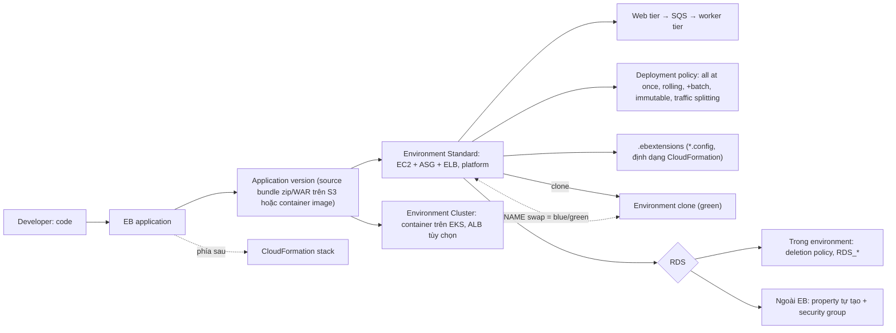

# 23 Elastic Beanstalk

Chương mới theo bản khóa mới, về AWS Elastic Beanstalk (EB), nền tảng PaaS cho developer: chỉ đưa code, EB dựng và quản lý môi trường bằng CloudFormation phía sau. Gồm kiến trúc hai chế độ Standard (EC2, ASG, web/worker tier) và Cluster (container trên EKS), application, version và environment, các deployment policy từ all at once tới traffic splitting, clone environment và blue/green bằng CNAME swap, cách dùng RDS cùng EB, và tùy biến bằng .ebextensions. Chuỗi demo dùng ứng dụng RooTube. Đề hỏi EB theo kiểu "developer deploy web app nhanh, ít vận hành" và "chọn deployment policy nào".

← [[00 Home]] · Trước: [[_MOC 22 Systems Manager]] · Tiếp: [[Exam Cheat Sheet]]

## Lộ trình học
1. [[Elastic Beanstalk]]: PaaS cho developer; Standard (EC2, platform, web/worker tier, SQS) và Cluster (EKS); application, version (source bundle trên S3), environment, CNAME swap; database để ngoài.
2. [[Elastic Beanstalk Deployment Policies]]: all at once, rolling, rolling with additional batch, immutable, traffic splitting (canary, cần ALB); blue/green không phải policy.
3. [[Elastic Beanstalk Cloning and Blue-Green]]: clone environment (không copy data RDS, chỉ platform version cùng branch), swap environment domain để blue/green, lifecycle policy cho version.
4. [[Elastic Beanstalk and RDS]]: RDS trong environment (deletion policy Delete/Snapshot/Retain, property RDS_*) hay ngoài EB; tách RDS: Retain trước rồi Decouple.
5. [[Elastic Beanstalk ebextensions]]: thư mục .ebextensions ở gốc source bundle, file .config định dạng CloudFormation; option_settings, Resources (chỉ Standard).

## Bản đồ khái niệm

## Liên kết sang section khác
- Hạ tầng EB tạo thay bạn: [[Auto Scaling Groups]], [[Elastic Load Balancer]], [[SQS]], [[EKS]], [[ECR]]
- CloudFormation phía sau: [[CloudFormation Basics]], [[cfn-init]], [[CFN Deletion Policy]]
- DNS và chia traffic: [[CNAME vs Alias]], [[R53 Weighted Routing]]
- Database: [[RDS Architecture]], [[RDS Security]]

## 🎯 Top mẹo thi của section
- Developer deploy **web app** nhanh, **không quản lý hạ tầng**, ít sửa code, team nhỏ → **Elastic Beanstalk**; microservices/serverless thuần → ECS/EKS/Lambda. ([[Elastic Beanstalk]])
- "Source bundle" → EB (zip/WAR trên S3); ngôn ngữ không hỗ trợ sẵn → **Docker platform**; container trên Kubernetes mà không tự vận hành EKS → **cluster mode**. ([[Elastic Beanstalk]])
- Xử lý nền tách khỏi web → **worker tier** + SQS (Standard). ([[Elastic Beanstalk]])
- **All at once** nhanh nhưng downtime; **rolling** giảm capacity, không tốn thêm; **rolling + additional batch** giữ 100%; **immutable** rollback an toàn nhất; **traffic splitting** = canary, cần **ALB**. ([[Elastic Beanstalk Deployment Policies]])
- Bản mới không chạy chung được bản cũ → **blue/green**: clone + **CNAME swap**, giữ environment cũ tới khi DNS hết hạn. ([[Elastic Beanstalk Cloning and Blue-Green]])
- Clone **không copy dữ liệu RDS**, không mang unmanaged change. ([[Elastic Beanstalk Cloning and Blue-Green]])
- Production → **RDS ngoài EB** (property tự tạo, mở security group); tách RDS đang gắn → **Retain, đợi xong, rồi Decouple**. ([[Elastic Beanstalk and RDS]])
- Tùy biến/thêm resource cùng code → **`.ebextensions`** (gốc source bundle, `.config`, định dạng CloudFormation; chỉ Standard). ([[Elastic Beanstalk ebextensions]])
